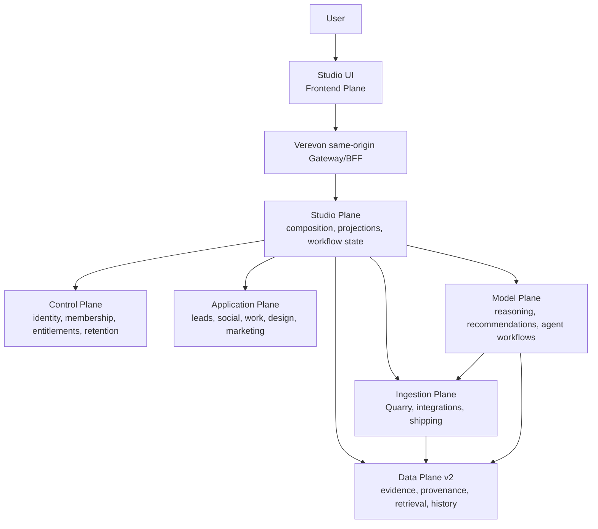
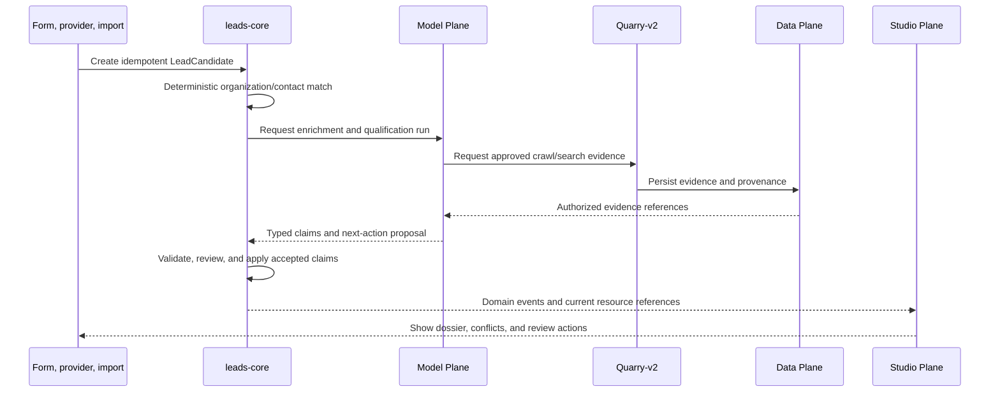

> Product naming: Engagement Plane is the canonical product boundary. The old
> Marketing backend now lives in `../engagement-plane/visibility-core`; this
> directory retains deployment compatibility. See
> [Engagement ownership and migration](../engagement-plane/README.md).

# Verevon Studio Plane

**Status:** Canonical local runtime; provider connections must be established again after a fresh database rebuild

**Last updated:** 2026-10-24
**Product owner:** Studio  
**Runtime position:** Composition layer between the Frontend Plane and existing domain authorities

## Purpose

Studio is the place where users turn trusted business signals into approved work.

It brings lead intelligence, competitor monitoring, marketing, human work
management, design, and shipping into one coherent Verevon workspace. Studio is
not a second implementation of those domains. It composes their data, actions,
approvals, and workflows while each canonical domain remains owned by its
existing plane and core.

## Unified local Compose

The supported development runtime uses the **plane-level Compose entrypoints**:

- Full Control Plane: `../Control Plane/docker-compose.yml` (all six cores).
- Full Studio Plane: this directory's `docker-compose.yml` (Social, Leads,
  Marketing and Anbud, plus their infrastructure).
- Ingestion: `../Ingestion Plane/docker-compose.yml`, restricted to Quarry-v2,
  Integration Core and their required infrastructure.
- Frontend: Verevon v3 SPA, Rust gateway and shared NATS hub through
  `../Frontend Plane/verevonv3/docker-compose.yml` at `http://localhost:5173`.
  Authenticated Marketing Pulse is at `http://localhost:5173/studio/pulse`,
  using the shared dashboard implementation and a session-checked gateway
  adapter, not the no-auth demo proxy. The current Marketing Core deployment
  has an explicit organization binding; other workspaces fail closed.
  The standalone Studio demo on port `5174` is retired; Verevon is the only
  supported Pulse frontend. The combined launcher no longer starts or inspects
  the demo. Demo-only container/dependency caches may be pruned, but its source
  and historical setup notes remain for reference; shared backend data and
  credentials are not part of that cleanup.
  Model Plane and the separate organization website frontend are not started.

From this directory, after the one-time local provisioning below:

```sh
node scripts/studio-runtime.mjs config  # validates without displaying secrets
node scripts/studio-runtime.mjs up      # builds/starts each canonical owner
node scripts/studio-runtime.mjs status
```

The launcher uses the existing protected deployment inputs and small overrides;
it does not replace the canonical plane Compose files with standalone services.
The Ingestion override retains the existing external Integration database volume,
vault key, localhost OAuth callback and provider-secret mounts. See
`../Ingestion Plane/docs/runbooks/studio-local-subset.md` for migration/rollback.
Former standalone Integration/Quarry containers must be stopped before the
canonical services start. Never attach two database containers to that volume.
Do not use volume/system prune or `down -v` during this transition.

### Fresh development databases

Use this path only when an empty development stack has been explicitly chosen.
It does not restore accounts, OAuth grants, website mappings or saved reports.
Keep the protected deployment files and any backups; do not rotate their keys
or import an old Integration database independently of its organization authority.

The canonical frontend and Integration overlays declare external volumes so a
normal migration cannot silently replace existing storage. On an empty Docker
installation, provision their empty volumes before starting the combined runtime:

```sh
docker volume create verevon-nats-data
docker volume create studio-integration-local_integration-postgres-data
```

Complete the dedicated Anbud database setup below before starting the full
runtime. After startup, Verevon requires account registration/sign-in and workspace
setup. Its private Marketing routes continue to require a session. The local
Marketing deployment remains explicitly bound to one organization; align that
deployment and its scoped service connections with the actual workspace before
reconnecting providers. A retained OAuth client configuration is not a restored
user grant, and an old organization ID is not a newly created workspace.

When rebinding an empty development deployment to a newly created workspace,
the protected `marketing-integration.json` may specify `dataVolume`, for example
`studio-plane_marketing-workspace-<organizationId>`. This selects a separate
Marketing projection volume; it does not relabel or migrate another workspace's
registries. Omitting the field preserves the historical volume name. The old
volume stays untouched, and each registry still checks its organization binding.

Verevon onboarding now saves the supplied website through the same
`marketing.websites.add` contract as Pulse after organization creation, and
idempotently checks that registration again when finishing resumed onboarding.
Marketing queues bounded discovery and mobile/desktop PageSpeed preparation on
first save. The pre-workspace preview uses Quarry's bounded public-page evidence
contract, including individually validated redirects. It shows measured page
metadata, not a durable knowledge-base ingest or a full crawl. Failed or empty
previews are not successful completion receipts. Google and other private
provider reports still require account consent and site/resource mapping.

Google Workspace onboarding now explicitly requests Integration Core's
`workspace_readonly` bundle: Drive, Gmail, calendar, Search Console and GA4 read
access, without sending mail, managing ads or editing properties. Microsoft 365
has its corresponding read-only Graph bundle. Existing minimal grants do not
silently acquire new permissions: the account owner must approve incremental
consent. The provider's confirmed granted scopes remain the authority.

Marketing observes its organization's Google connection metadata once per minute.
A changed account, grant status or permission set triggers registered-site
resource discovery through Integration Core and preparation of missing reports.
Per-site connection fingerprints are saved in the private website registry, so
unchanged connections do not repeat provider discovery on restart. Missing jobs
are reconciled separately, and explicitly paused analytics/public jobs stay
paused. Dashboard reads remain reads. This is bounded single-process polling,
not a new cross-plane database path or a claim of distributed event delivery.

The canonical launcher projects the existing Microsoft client through
`INTEGRATION_LOCAL_MICROSOFT=1`, including a protected Integration-only client
secret mount. The configured public/confidential client mode is preserved;
Microsoft's registered callback/client settings still determine live consent.
Microsoft Graph consent does not grant Clarity Data Export access. Clarity needs
its project-admin export token, stored and mapped by Integration Core.

Google Trends has an explicit, development-only `pytrends` fallback through
Integration Core → Marketing Core → Pulse. The official API remains a separate
access-controlled alpha; Workspace consent alone does not prove access. The
archived `pytrends==4.9.2` dependency runs in a non-root private sidecar, enabled
only by `INTEGRATION_LOCAL_TRENDS=1` in the canonical local Ingestion launcher.
Production Integration environments ignore the feature even if enabled.
There is no published worker port, account-cookie import, proxy rotation or
CAPTCHA bypass. Marketing's background worker selects up to five unique,
printable queries with observed impressions from the newest fresh, authorized
saved Search Console projection for each registered site. It ranks impressions,
then clicks, skips unsupported/overlong terms, and canonicalizes the chosen set
to prevent rank-only churn. Worldwide interest over the last 12 months is the
automatic default; the source query period is displayed separately. No domain
guesses or sample keywords are substituted when Search Console is unavailable.
The worker checks saved keywords on each minute-spaced pass and collects a daily
report through Integration Core. It doesn't depend on Pulse being open. Reads
may check Integration authorization metadata, but never collect provider metrics.
Manual research with 1–5 terms, country and period remains under Advanced.
Results are relative 0–100 interest within the same request, not absolute search
volume, with observed time, country, period and partial buckets preserved.
Integration's worker caches up to 64 query reports in memory for 24 hours.
Marketing saves automatic reports and retry times in its existing organization's
private volume (`trends.json`, mode 0600, bounded to 64 sites / 8 MiB, atomic
replacement), and never promotes them into work findings or analytics totals.
Reports expire based on the provider's original observation time, not cache-read
time. Keyword evidence, website revision and current GSC authority are checked
before returning saved results and again after collection. Missing, stale,
revoked or changed keyword evidence hides old results. No keywords is distinct
from no Trends coverage, a timeout, or a quota refusal. Provider backoffs survive
a Marketing restart; a restarted running job is retried on its saved due time.
The existing service-bearer renewers re-check absolute expiry during waits in
30-second slices, so local VM resume/clock corrections do not leave them asleep
until after an old monotonic deadline. Their audiences and scopes are unchanged.
Requests are serialized, bounded to 25 seconds, spaced at least 60 seconds;
429/403 responses pause upstream work for an hour, other failures for 15 minutes.
Unavailable and no-data results have no synthetic zero series. A worker restart
clears its dev cache and cooldown, so do not restart it to circumvent a refusal.

One-time Anbud setup (creates only its dedicated local database and roles):

```sh
sh scripts/provision-local-secrets.sh
sh scripts/studio-compose.sh up -d studio-postgres
node scripts/provision-anbud-database.mjs          # inspect the plan
node scripts/provision-anbud-database.mjs --apply
```

Anbud's API uses a restricted runtime role. Only the one-shot `anbud-migrate`
job receives schema-owner credentials; provider-template `.env` values are not
wholesale injected. The full runtime enables the `marketing` and `anbud`
profiles. Studio Core is currently a design document, not an executable service.
The older standalone `marketing-local`, `studio-integration-local`, and
`studio-quarry-local` stacks are compatibility/rollback artifacts, not the
supported startup path.

### Bounded audit-to-work loop

Verevon Pulse now exposes **Site audit** through its authenticated Marketing
gateway. Reads never start captures; a person explicitly starts a run. Marketing
Core discovers a public URL inventory with Quarry and captures at most ten pages
with two concurrent capture slots. Quarry's dedicated `/v1/audit/page` contract
is static-only, credentialless, DNS-pinned, limited to 1 MiB and ten seconds per
page, and permits at most three individually validated HTTPS redirects within
the exact apex/www pair. Generic scrape/browser fallbacks are not used.

The first rule version checks observed title/description signals, HTTP errors,
duplicate titles across distinct effective URLs, same-site canonical differences
requiring review, and links to checked pages returning 404/410. This is a bounded
sample, not an exhaustive crawl, full heading audit, search ranking guarantee or
site-health score. Unknown/unvisited/failed pages are never silently counted as
healthy. Public inventory URLs retain their observed hosts; no synthetic URL
rewriting is used to hide canonical redirects.

Marketing stores compact evidence in private `audits.json` beside the existing
website/work registries: five receipts per site, twenty per organization, at most
2 MiB. No raw HTML, browser artifacts or provider credentials are stored there.
The store is single-process like the current registry; it is not a scalable job
queue. Runs are asynchronous but manually triggered, have a 200-second deadline
and a 60-second site cooldown, and interrupted runs are marked on restart.

Saving a finding accepts only `auditId` and `findingId` plus the current website
binding. The server selects the original evidence and deduplicates page/rule
tasks in the existing queue. After a fresh audit, **Confirm latest audit check**
records newer measured evidence and history without automatically closing work.
A newer failed, running or unmeasured audit cannot fall back to an older passing
result. Assignment, editable priorities, alerts, distributed quotas and full
multi-tenancy remain subsequent slices.

### Scheduled bounded monitoring

Pulse's **Scheduled monitoring** controls are opt-in per registered website. Daily
means an elapsed 24 hours and weekly means seven elapsed days, using UTC rather
than a local wall-clock time. Enabling or resuming schedules the first capture
one full interval later; opening or refreshing the panel never starts captures.
Pause stops future dispatches, not a capture already in progress.

Marketing persists schedule state and scheduled audit receipts together in its
protected `audits.json`, before dispatching Quarry. This prevents a restart
between scheduling and recording a run from creating duplicate attempts. Missed
intervals are coalesced rather than replayed as a catch-up storm. Scheduled work
shares manual auditing's capture/run limits; capacity deferral does not invent
an audit receipt. Transient failures have bounded retries, while permission,
policy and configuration failures require review. Website or mapping revision
changes stop execution until the current binding is explicitly confirmed again.

The API is `GET/PATCH /api/v1/marketing/monitoring`, scoped to the registered
website and current authenticated workspace through Verevon. Configuration uses
an optimistic schedule revision; neither users nor agents supply organization,
dispatch, provider or bearer values. The panel exposes a bounded execution
history, not long-term analytics, an exhaustive health score or automatic task
resolution. Scheduling is a single-process Marketing Core worker, not a
multi-replica distributed queue. Notification delivery and governed MCP access
remain separate follow-up work.

### Audit changes, alerts and weekly reports

Pulse reads `GET /api/v1/marketing/audit-insights` and
`GET /api/v1/marketing/reports/weekly` through the same authenticated gateway.
These reads do not start captures or modify work tasks. In-app alerts live in
Pulse; this slice does not send email or create global notification deliveries.

Marketing records a compact condition ledger and UTC weekly observations in the
same protected audit transaction as the terminal run, before full reports are
evicted. A first observed issue is new; an unresolved issue observed again is
unchanged. A regression requires a previously observed issue, a proven passing
resolution, and a newer failure. Missing, skipped, failed or inconclusive checks
are unknown, not resolved. Proof includes its actual audit and capture IDs; old
proof is never presented as a new observation.

Resolution requires the same website revision, rule version and effective page
URL. Duplicate-title partners and previously broken link targets must also be
captured successfully; a narrower sample or a disappeared capped link list is
not sufficient. Contradictory captures of the same effective page are not used
to claim a fix. Existing task verification follows these conservative evidence
checks and still does not automatically close tasks. If an original task's
audit is unknown, or retention pruning has broken its condition's proof chain,
verification stays inconclusive rather than accepting a later unrelated fix.

Weekly periods are Monday-to-Monday `[start, end)` in UTC. The current period is
provisional; past periods are closed calendar windows, not guarantees of complete
monitoring. Reports count audit/page/check observations rather than unique pages
or site-wide health. Outstanding-work counts are a current snapshot explicitly
labelled `tasksAsOf`, not reconstructed historical backlog at the week's end.

The ledger retains bounded conditions and eight weekly buckets, with bounded
execution receipts. History/size pruning is disclosed with partial, limited or
truncated flags. On upgrade, only actual retained audits can be backfilled;
missing older history cannot be recovered or inferred. These summaries survive
normal full-report eviction, but remain single-process, local-volume projections
with the existing 2 MiB storage ceiling—not an unlimited analytics warehouse.

### Website preparation and connect-once rollout

The user-facing target is: register a public URL, approve provider consent once,
discover authorized resources, resolve ambiguous matches, collect evidence in
background jobs, and open Studio on saved, dated projections. Provider passwords
are never collected. Integration Core owns OAuth grants, refresh/revoke handling
and project tokens; Marketing stores site bindings and derived work. DNS or
read-only reporting access does not authorize project creation, tracker installation
or advertising spend. Reconnection can still be required after revocation, new
permissions, provider policy changes or development-app consent expiry.

The current first slice adds `GET/POST /api/v1/marketing/preparation` and
`GET /api/v1/marketing/sources`, requiring an exact registered `websiteId`/`site`.
POST additionally requires its current `websiteRevision`; gateway writes require
an administrator and the configured same origin. Saving a newly added/changed URL
or rechecking its account mappings queues public Quarry discovery and mobile/
desktop PageSpeed checks. Existing registered sites are not silently reprocessed
at startup. Admins can explicitly prepare/retry them in the website manager.

Preparation receipts are protected, atomic, organization-bound local JSON
(`preparation.json`, 32 sites, 1 MiB), with two workers, a three-minute source-work
deadline and a terminal retry cooldown. GET does not start work. Revision changes
hide old receipts and stop stale phases from being accepted. Recovery preserves
finished phases and marks interrupted phases rather than blindly repeating them.
Receipt-only persistence retries do not repeat provider calls. These guarantees
are single-process/local-volume, not a distributed workflow service.

**Public preparation receipts are durable; Quarry inventory and Integration Core
PageSpeed caches remain ephemeral.** Private GSC Pulse/search, GA4 and Clarity
panels now read normalized durable snapshots, not provider metrics on page load.
`GET /api/v1/marketing/analytics-sync` reads lifecycle metadata; admin-only POST
collects the selected current-year quarter and enables periodic sync, while PATCH
pauses/resumes future sync. These routes require exact website/site/quarter context;
writes also require the current website revision and same-origin gateway authority.
URL add/change and successful mapping checks enroll the current quarter, but
existing sites are not silently enrolled at startup. Selecting a different quarter
only reads saved state; use its explicit collection control if needed.

Protected atomic `analytics.json` storage is organization-bound and bounded to
64 site/quarter entries and 8 MiB, with two joined workers, a 90-second collection
deadline, six-hour freshness, hourly failed-source retry, and a one-minute manual
cooldown. Expired metric payloads are purged after 24 hours. Save-only retries do
not recollect provider data. Interrupted collection can retry up to three attempts,
then records an explicit interrupted failure. Old-year
schedules stop rather than silently changing reporting periods; quarter rollover
still needs explicit enrollment. Pausing does not delete data or revoke grants.

Every private snapshot read rechecks fresh Integration connection metadata;
known revoked/deleted/mis-scoped connections hide data immediately. Clarity checks
the exact operator-approved site/project/binding version without exporting again.
Registry revision changes hide earlier snapshots. This does not instantly detect
revocations unknown to Integration: external provider changes are discovered on
subsequent provider calls, with a six-hour maximum snapshot freshness window.
An upstream cached observation also expires six hours after its own timestamp;
collecting it again does not reset that source's age.
Failures remain unavailable/null, never synthetic zero. Clarity retains its own
rolling 72-hour window independently of the selected search quarter. Separate,
explicit search-comparison analyses still read through Integration on demand.

Source catalogue flags identify private panels as `snapshot_read`;
`available` means an implemented capability, not verified credentials or a passed
measurement. Planned entries do not collect data and are not connected accounts.

The configured Google return path now defaults to Verevon at
`http://localhost:5173/studio/pulse`, not the retired demo. Override
`MARKETING_GOOGLE_CONSENT_RETURN_URL` and `MARKETING_GOOGLE_OAUTH_CALLBACK_URL` for
deployment; configure the same callback in Verevon's
`VITE_MARKETING_GOOGLE_OAUTH_CALLBACK_URL`. Integration Core's return-origin
allowlist and Google's registered callback still independently apply.

### Public field performance and archive evidence

CrUX and Common Crawl use a separate end-to-end public-signal workflow:
Integration Core owns fixed-provider requests and any deployment key; Marketing
Core owns bounded per-website projections and background collection; Verevon
exposes the same organization-scoped contracts to its authenticated users.
No customer OAuth consent is required for these public reports. This does not
confer ownership or permission to install tags, edit websites, or advertise.

`GET /api/v1/marketing/public-signals?websiteId=…&site=…` only reads saved state.
POST with `websiteId`, `site`, and `websiteRevision` queues collection and enables
daily background updates. PATCH with the same context plus `enabled` pauses or
resumes future collection. Writes require an owner/admin and same-origin gateway
authority. New/changed URL and successful mapping mutations enroll the current
website revision; existing sites are not silently enrolled at startup.

Marketing stores protected atomic `public-signals.json` projections, bounded to
32 websites / 2 MiB, with two joined workers, a 40-second collection deadline,
24-hour freshness, six-hour failed-job retry, a one-minute manual cooldown and
48-hour metric-payload retention. Receipt-only persistence retries do not repeat
provider calls. Report expiry hides measurements but keeps the dated receipt;
revision changes hide the old report. Pause does not delete data; resuming an
expired report queues a new collection instead of waiting another day. These are
single-process/local-volume guarantees, not distributed scheduling.

Integration's `POST /api/v1/insights/public-signals` accepts only `{site}` under a
verified organization and `integration:read`. It performs fixed-endpoint public
reads, never follows supplied archive/provider URLs, downloads WARC/HTML, or
creates provider resources. Common Crawl calls are serialized process-wide with
a two-second minimum interval and bounded responses, using the latest validated
index and at most 20 records for the exact host. Archive dates and HTTP statuses
describe historical captures, not current crawl health, backlinks, AI training,
or current search visibility. Query strings and sensitive paths are excluded.

Successful Common Crawl collection metadata is cached for 30 minutes, with
concurrent refreshes coalesced; expired metadata is not reused after a failed
refresh. An index query can retry an explicit HTTP 502/504 once, through the same
serialized gate and within the existing 30-second collection budget. It never
retries HTTP 429/503 immediately, switches hosts or searches older indexes to
work around an outage. Metadata 404 means the provider is unavailable; only an
actual index-query 404 means no captures were found in that index. Provider
deadlines and HTTP 504 use the closed `timeout` reason, retained by Marketing's
saved reports and shown separately from `no_data` in Pulse. The chosen index
remains visible even when its query fails.

CrUX reports exact-origin PHONE and DESKTOP p75 LCP/INP/CLS measurements for the
provider's 28-day field-data window, separate from Lighthouse and Pulse's selected
quarter. Missing metrics and low-traffic absence stay unavailable/null. No www
fallback or fabricated zero/overall Core Web Vitals pass is inferred.

CrUX's `no_data` outcome is not an account connection failure. Google can omit
origins or device segments that lack sufficient eligible Chrome traffic or do
not meet public indexability requirements. Connecting GA4/Clarity or publishing
their tracking tags does not enroll an origin in CrUX. Pulse links to Google's
coverage criteria and keeps missing field data distinct from Lighthouse lab
results; it never substitutes measurements from another origin or control site.

CrUX requires a dedicated key restricted to Chrome UX Report API, enabled in the
deployment's Google project. It does **not** reuse the PageSpeed-restricted key.

### Cookiebot and Algolia site sources (development setup)

Algolia OAuth follow-on: the official
[Productivity MCP](https://www.algolia.com/doc/guides/model-context-protocol/productivity-mcp)
advertises dynamic public-client registration, S256 PKCE and a read-only,
user-scoped account connection. On 23 October 2026 its registration endpoint
accepted our **own** Integration Core client and the fixed local callback
`http://localhost:3026/api/v1/providers/algolia/callback` (HTTP 201). This is not
the Algolia CLI's client identity. The operator registration is private at
`.local/secrets/integration_algolia_oauth_client.json` (version/clientId/
redirectUri/resource only, mode 0600). `INTEGRATION_LOCAL_ALGOLIA_OAUTH=1`
mounts it only into Integration with `ALGOLIA_MCP_OAUTH_CLIENT_FILE`; keep this
flag alongside the existing overlays when recreating Integration. No client
secret is used or requested. The runtime plan preserves this overlay.

User consent and the account's Productivity MCP enablement remain required;
client registration alone does not connect any account or provide analytics.
The OAuth bearer is scoped to `https://mcp.algolia.com/mcp`, never used against
the REST Analytics host. Only bounded resource discovery, aggregate analytics
and aggregate search-term report tools are permitted by our collector. App/index selection is explicit and is
not evidence of website ownership. Google/Clarity mappings remain independent.

In Pulse, use **Logg inn med Algolia**, approve the read-only account connection,
then choose among authorized applications and indices. Unique eligible choices
can be selected automatically; ambiguous indices still require a choice. Saving the website
mapping validates that resource through Integration and queues the initial
background report. Both the UI and service API use this same mapping. Removing a
website mapping stops its OAuth-backed reports and prevents fallback to an old
local key binding; it does **not** revoke the account's provider-side consent.
Provider revocation is not advertised as supported until Algolia's inconsistent
revocation metadata is independently verified. Tokens and refresh credentials
remain encrypted in Integration; Marketing and the browser receive metadata and
bounded normalized reports, including aggregate search terms, not raw search events
or user/session identifiers. Search terms are private report data and must never
be copied into diagnostic logs, telemetry or error messages. The current registration/callback configuration is for
local development, not a production OAuth deployment.

Local verification (23 October 2026): OAuth consent completed with the registered
client and authenticated MCP initialization/tool listing succeeded. The canonical
Integration service now supports the live `algolia_discover_tools` →
`algolia_describe_tool` → `algolia_call_read_tool` transport as well as direct
logical tools. Outer and inner schemas are checked, operations must prove their
read effect, and only fixed account/index metadata and report operations are callable. User
prompts and optional intent fields are never sent. Calls remain grant-checked.
Metadata sessions are bounded to twenty seconds/fourteen RPCs; report sessions
have thirty seconds/eighteen RPCs for the three independent report components.

Live verification now covers automatic application and index discovery through
Pulse. The hosted list-indices schema has no application-ID enum; instead,
Integration discovers/describes the fixed read operation
`algolia_application_list`, validates its empty input and projects only
`applications[].applicationId` (at most 128 unique IDs). Pulse discovered
`JL96OC7GC2` and then received its real `development` and `everything` indices.
Only this additional account-metadata read was added to the fixed allowlist;
other discovered operations remain blocked. A separately labeled manual ID
fallback also verifies actual index access, never treating the supplied ID as
permission proof. Any provider-supplied ID enum still restricts requests.

That application belongs to Aquatiq, not Triodelab. The selected reporting index
is `everything`. Our custom DNS ownership gate is retired: account consent,
organization access, the exact website mapping and current provider-resource
permission authorize read-only reports. This does not grant authority to install
tracking, publish content, alter provider resources or spend advertising budgets.
Neither another site's mapping nor arbitrary operation dispatch is an acceptable
workaround. Pulse loads account grants
independently of site-mapping access, while saving/disconnecting requires the
current site's mapping access. Changing the grant/application clears index
proof, and stale responses cannot enable saving.

Algolia reports cover the last seven completed UTC dates, independently of the
Pulse quarter. Aggregate totals, top searches and searches with no results have
independent availability. Term lists contain at most twenty rows; they are not
complete event logs and their counts must not be presented as the overall total.
An explicit empty provider list is different from an unavailable report.

Live upstream verification (23 October 2026): the registered Aquatiq website and
its selected `everything` index returned HTTP 200 through the existing
organization-scoped service connection. Aggregate analytics and both term-list
components were connected for 16–22 October, with twenty rows in each shortlist.
The diagnostic receipt recorded only availability, window and row counts—not
search-term values.

Downstream verification also completed in Verevon's in-app browser: choosing the
existing account automatically discovered the application and both indices;
saving Aquatiq's selected `everything` mapping queued server-side collection.
The durable job reached `ready` at `2026-10-23T14:17:12Z`, scheduled its next run
six hours later, and populated both twenty-row Pulse tables. A page reload read
the same saved report and did not start another provider collection. The report
showed 1,726 searches and 1,071 searches without results for the stated UTC window;
blank searches are actual provider observations and remain explicitly labelled.
Anonymous direct Core and gateway report/collection reads returned 401.

Verification caveat: after that successful browser and reload check, Docker Desktop
shut down its engine at `2026-10-23T14:20:22Z` because writing its VM log failed
with `no space left on device`. This made the local frontend/Core ports unavailable.
No containers, volumes, credentials or user files were deleted. Temporary build
space subsequently became available, but the supported Desktop restart command
timed out waiting for its backend processes to stop. Docker Desktop needs operator
recovery before the canonical stacks and final screenshot can be rechecked.
Scoped Algolia/collection tests, lint, typechecking and build passed; broader suites
also reported separate concurrent `FY` period-contract mismatches, left untouched.

Marketing owns the protected report snapshots and a separate durable collection
queue. Saving a mapping starts collection; report/status reads do not. Two bounded
workers retry failed jobs and refresh mapped resources approximately every six
hours, including a new UTC reporting window. Job state is separate from the
OAuth-bound report digest. Changing a URL, unmapping a resource or known grant
revocation invalidates pending work and cached report authority. OAuth refresh
normally avoids another sign-in, but revoked/expired consent or provider policy
changes can still require reconnecting.

The former Studio `/ownership/challenge` and `/ownership/verify` API routes are
retired (410). Historical ownership facts remain readable for compatibility, not
as prerequisites for connected reporting. `/websites/{id}/verify` refreshes provider
access; it is not a DNS challenge. Public URL validation and DNS/SSRF protections
remain enforced. Older setup notes below describing the custom DNS workflow are
historical and superseded by this connect-once reporting flow.

Algolia Productivity MCP is an **upstream provider protocol** here: Integration
is its MCP client, while Verevon uses Marketing's site-scoped capability API.
This connection does not itself configure Claude/ChatGPT or expose Algolia's
complete toolset through a Marketing MCP server. Agent access must reuse the
same governed Marketing capabilities and organization/site permissions rather
than create another copy of the user's Algolia credentials.

Cookiebot's documented
[consent Data API](https://support.cookiebot.com/hc/en-us/articles/4405045044882-Extracting-consent-data-via-API)
requires its account API key. Its separately documented
[Dashboard API integration](https://support.cookiebot.com/hc/en-us/articles/360016881479-Umbraco-installation)
uses client ID/secret credentials; this is not proof of a public end-user OAuth
authorization flow for the Data API. No such flow was verified, so Cookiebot
must not be offered a fake OAuth sign-in button. Its API-key setup below stays
explicit. Algolia's analytics-key setup remains a fallback, not its preferred
OAuth onboarding path.

Existing Cookiebot and Algolia installations connect through Integration Core;
Marketing persists bounded aggregate reports and Pulse displays them. This is
read-only reporting, not a CMP/search installation or automatic account setup.
No tracking, consent decision, index, ad campaign or provider setting is changed.

Run `node scripts/prepare-site-source-secrets.mjs` once to create protected
mode-0600 placeholders under the existing mode-0700 `.local/secrets` directory:

- `integration_cookiebot_data_api_key`: Cookiebot Manager's **Data API** key.
- `integration_algolia_analytics_api_key`: an existing app's key with the
  **analytics** ACL and access to the selected index, not an Admin key.
- `integration_marketing_providers_bindings.json`: initially
  `{"version":1,"installations":[]}`. Empty keys remain unbound and no upstream
  requests are made. Running the command again preserves existing files.

Enter keys using a local editor, never chat, shell arguments, screenshots or a
browser form. After entering keys, add only the corresponding configured
provider to the protected binding manifest, for example:

```json
{
  "version": 1,
  "installations": [{
    "organizationId": "<current verified organization>",
    "websiteId": "<registered website ID>",
    "websiteRevision": 1,
    "site": "https://example.com/",
    "cookiebot": {
      "domainGroupId": "<existing domain-group UUID>",
      "domain": "www.example.com",
      "culture": "default",
      "apiKeyFile": "/run/secrets/cookiebot_data_api_key"
    },
    "algolia": {
      "applicationId": "<existing application ID>",
      "indexName": "<exact index name>",
      "region": "de",
      "analyticsKeyFile": "/run/secrets/algolia_analytics_api_key"
    }
  }]
}
```

Replace all placeholders and use the registry's **current** revision; never
reuse an old mapping after changing a URL. `region` is the application's
Analytics region (`us` or `de`), not the visitor's country. Cookiebot's domain
must match its registration; the canonical origin or its `www` alias is allowed.
Omit either provider object until its key and mapping are ready. Keys do not
grant ownership of arbitrary sites. Current registry ownership and organization
permissions remain mandatory.

Add `INTEGRATION_LOCAL_SITE_SOURCES=1` to the existing canonical Ingestion
launcher command, retaining all existing Meta/PageSpeed/Clarity/CrUX/Web Vitals
and shared-NATS flags. It adds `docker-compose.integration-site-sources.local.yml`
and mounts all three files **only into Integration Core**. The unified
`scripts/studio-runtime.mjs` plan retains this overlay. Recreate Integration after
changing mounted files, then use the administrator action **Fetch Cookiebot
report** / **Fetch Algolia report** in Pulse. **Refresh saved status** is
GET-only and never calls a provider.
Do not source the manifest as shell code or copy API keys into frontend envs.

The original API-key fallback described above does not use the existing Google OAuth grant.
A future Cookiebot portal credential workflow
must retain the same organization/site permissions and protected storage; this
local key setup does not claim zero-effort OAuth discovery. Refreshes collect the
last seven completed UTC days, independently of Pulse's selected quarter.
Snapshots remain fresh for up to six hours, expiring sooner at UTC date/window
rollover; permission changes are discovered on provider refresh. Expired
snapshots are hidden on read and pruned on the next write, not guaranteed to be
physically deleted at the exact expiry time.
Cookiebot consent totals count events, not visitors, and cookie inventories
reflect a dated scan—not a legal-compliance verdict. Algolia returns aggregate
search and no-result counts only, never raw search strings.

Original API-key slice verified locally on 23 October 2026: Integration, Marketing and Verevon gateway
rebuilt healthy; both administrator fetch actions round-trip from Pulse through
Marketing to Integration and return `not_configured` for the intentionally
empty bindings. Subsequent saved reads return that result without metrics.
Missing authentication returns 401, an old website revision 409, and unknown
provider/organization fields 400. Browser console had no errors or warnings in
the checked session. Real Cookiebot data remains pending the operator's Data
API key and binding; Algolia additionally has the OAuth path described above.
Its live account analytics remain pending actual consent, authorized resource
selection and a successful provider report; fixture tests are not live evidence.

### First-party Web Vitals (local development)

First-party Web Vitals use a separate per-site exporter through Integration
Core, not a public Marketing collector. The optional local
`INTEGRATION_LOCAL_WEB_VITALS=1` overlay requires mode-0600
`.local/secrets/integration_web_vitals_bindings.json` and
`integration_web_vitals_triodelab_development_export_token`. It mounts these
only into Integration Core. Bind the exact organization, website ID, current
revision, environment, reporting origin and approved public paths. Development
uses `http://localhost:3000` with the explicit container-only
`http://host.docker.internal:3000` egress exception; production never allows
private origins. Every installation needs its own export credential.
Marketing's signed organization connection pulls bounded receipts, stores
latest measurements for seven UTC calendar days and serves nearest-rank p75
per viewport group. Pulse import is currently explicit, not scheduled; reads
never trigger provider access. Production needs a reachable TLS Redis-backed
site exporter and a separately approved protected production binding.

For the current **development-only** setup, `STUDIO_WEB_VITALS_ENABLED=1`
adds `docker-compose.web-vitals.studio.yml` to the canonical Studio stack.
It runs `studio-web-vitals-dragonfly` on literal `127.0.0.1:6481`, separate
from the shared cache on 6480, with a dedicated named volume and protected
`.local/secrets/web_vitals_dragonfly_config` (mode 0600, one dedicated
`--requirepass=` flag). The collector's protected development Redis URL
points to database 15 on this service. Credentials never enter Compose
arguments or browser code. The process runs as the image's non-root `dfly`
user after its entrypoint initializes the volume.

Cache eviction and the HTTP console are disabled. Fixed-name snapshots
overwrite the previous files every minute and on graceful shutdown; a
30-second stop grace allows saving. This is development persistence, not
per-write crash durability: a crash can lose changes since the last
successful snapshot. Offline snapshot files remain until the next run/save;
this dev volume is not a production retention or backup guarantee. Do not
enable timestamped snapshot archives for measurement data.

Start just this storage service without touching the other cores:
`STUDIO_WEB_VITALS_ENABLED=1 sh scripts/studio-compose.sh up -d --no-deps --wait studio-web-vitals-dragonfly`.
The unified `scripts/studio-runtime.mjs` plan also retains the Web Vitals
storage and Integration binding overlays. No external Redis account,
Upstash setup, tunnel, public ingestion or live deployment is required.
Verified 23 October 2026: graceful restart restored a disposable test key
without extending its absolute expiry; unauthenticated access was denied;
the isolated collector/storage suite passed against this instance. The
test key was removed and the cleaned state snapshotted.

### CrUX deployment

The optional local overlay is `INTEGRATION_LOCAL_CRUX=1`, requiring a regular
mode-0600 `.local/secrets/integration_crux_api_key` under the existing private
secret directory; only Integration receives `/run/secrets/crux_api_key` through
`CRUX_API_KEY_FILE`. Keep all existing local Meta/PageSpeed/Clarity overlay flags
when recreating Integration. Without the key, the report explicitly says
`not_configured`; Google sign-in is not a substitute. Common Crawl needs no key.

The approved local deployment uses Google project `intergration-core` and the
dedicated `studio-crux-integration-local` key, restricted solely to
`chromeuxreport.googleapis.com`. Keep `INTEGRATION_LOCAL_CRUX=1` when using the
combined runtime launcher (`INTEGRATION_LOCAL_CRUX=1 node scripts/studio-runtime.mjs up`)
or recreating Integration through the Ingestion launcher; the secret itself stays
in the protected mount, never in source, frontend configuration or command output.
CrUX availability still depends on Google's origin/form-factor traffic coverage.

When provisioning or rotating Google API keys, capture **both** subprocess output
streams and never surface raw subprocess errors. `gcloud --format` alone does not
prevent operation-completion messages on stderr from including `keyString`.
Create with the API restriction already applied, separately verify metadata,
then retrieve into an exclusive mode-0600 secret file without printing it. Revoke
any accidentally exposed key rather than reusing it.

Provider references: [CrUX API](https://developer.chrome.com/docs/crux/api),
[Common Crawl index](https://index.commoncrawl.org/),
[CDX API](https://github.com/webrecorder/pywb/wiki/CDX-Server-API).

Remaining source rollout (catalogue registration is not an implemented connector):

| Source | Integration requirement / next delivery |
|---|---|
| Bing Webmaster | Dedicated Bing OAuth client and refresh lifecycle in Integration Core; discover verified sites and read permitted reports. Generic Microsoft Graph consent is not Bing consent. |
| Bing AI Performance | Bounded, provenance-labelled CSV imports first; no assumed public reporting API or all-AI coverage. |
| CrUX | Connector and Pulse workflow implemented above; live activation still requires the dedicated approved deployment key and API enablement. |
| First-party Web Vitals | Explicit consent-aware site installation and bounded ingestion; no retrospective data or automatic publication. |
| Google Trends | Dev-only pytrends research is available in Pulse with bounded queries, caching and cooldowns; official API access remains gated. |
| Common Crawl | Bounded Integration → Marketing → Pulse archive-index workflow implemented above; no key. No-data/unavailable reports are not proof that a site has never been crawled. |
| Google Ads | Account discovery/reporting through the correct grant and developer-token entitlement; no campaign creation/spend from onboarding. |

Before self-service activation for other organizations, replace Marketing's fixed
deployment organization with authorized per-organization storage/worker bindings.
Verevon currently fails closed for other workspaces; onboarding must not route a
new customer's data into the testing organization. Distributed job coordination,
provider-specific quota adaptation, user-facing deletion controls and automatic
quarter rollover are still needed beyond the bounded local snapshot workflow.

### Shared cross-plane event transport

`SHARED_NATS_ENABLED=1` links Studio's broker, Ingestion's broker and Control's
already-cross-plane shared broker to the Verevon-owned event hub. The combined
runtime launcher enables these links. Each link has a private, independently
revocable credential and a separate JetStream domain; existing local streams,
consumers and storage remain owned by their original plane.

The hub is internal Docker networking only; no NATS credentials are sent to the
browser. Only allowlisted organization lifecycle, aggregate Quarry, Integration,
and explicit Studio/frontend metadata event namespaces may cross links. GDPR,
audit, raw Social content, per-run Quarry events, private inboxes, JetStream
management and authentication/session RPC subjects remain private.

The hub's former token-only development authentication is replaced by scoped
users: `verevon-events` uses the preserved local credential as its password;
each leaf is restricted to leaf connections and its own publishing namespace.
Stopped legacy token-only clients must migrate before reconnecting. Do not run
the old Control compatibility event bridge alongside the leaf link.

These are live Core NATS transport links, **not** durable inter-plane replication
or automatic business workflows. Existing core HTTP APIs remain authoritative.
Social/Leads content and audit producers remain local; Marketing and Anbud need
explicit metadata producers/tenant-scoped consumers before their application
workflows use the shared namespaces. Do not treat broker connectivity as an AI
permission, tenant authorization or a completed integration.

`docker-compose.yml` uses the moved `./social-core`, `./leads-core`, and
`./marketing-core` Dockerfiles. `scripts/studio-compose.sh` reads the three
core-local `.env` files for Compose interpolation. It projects each core's
required settings by name: Social and Leads receive their own internal keys,
database and NATS settings; Marketing receives its internal key. All three
receive the same `INTEGRATION_CORE_URL=http://integration-api:3026` and join
`inter-plane-bus`. Unused
shared-template credentials do not enter any of those containers. The NATS
broker receives only the two scoped NATS passwords, not each core's `.env`.
The Go images exclude `.env` files from their build contexts. The Studio-local
NATS, JetStream, Prometheus, and Grafana configuration files live beside this
Compose file, rather than depending on the old Application Plane mounts.

The current Social/Leads `.env` files have `INTERNAL_API_KEY` and
`STUDIO_*_NATS_PASSWORD` entries. The binaries accept those scoped NATS names,
and Compose projects them to the broker without copying secret values into
another file. Compose supplies their shared database URL from the plane's
Postgres settings. The pre-existing core `.env` files contain identical
internal keys, so run `./scripts/provision-local-secrets.sh` once for a local
development stack. It creates distinct core keys and infrastructure passwords
under gitignored `.local/secrets/` (directory mode `0700`, file mode `0600`)
without printing values or changing `.env` files. The launcher reads those
files if present; otherwise, deployment-provided environment variables and
the core `.env` values remain the explicit fallback. It refuses shared core
keys and shared NATS user passwords before startup. Do not put these values in
source or chat. All four local core `.env` files are mode `0600`.

Leads has an incomplete billing credential trio in its existing `.env`. The
launcher omits all three billing settings until the complete, approved trio is
provided. The service can start, but entitlement-gated lead actions fail closed;
this is not a bypass or a substitute for billing setup.
Because Compose inserts the database password into a URL and NATS passwords
into config text, the launcher accepts only letters, digits, `.`, `_`, `~`, and
`-` for those passwords and the URL-embedded database user/name; provision
compatible values or switch the stack to a safe encoding/secret-file mechanism
before using other characters.

Validate the Compose syntax and interpolation with
`./scripts/studio-compose.sh config --quiet` after local secrets or deployment
variables are provisioned. This check does not validate every binary-level
requirement inside the service-local `.env` files. Use the same launcher
for `up -d --build`; start Marketing explicitly with
`./scripts/studio-compose.sh --profile marketing up -d --build`. A plain
`docker compose` command does not automatically read the service-local env
files for interpolation. The launcher creates the shared `inter-plane-bus`
bridge if needed for container-creating commands, but leaves it untouched for
`config` and `build`. Marketing's current `.env` contains legacy keys unused
by its present binary; the launcher prevents them from entering the container.
Projected core credentials must be unique, unquoted literal `KEY=value` lines;
the launcher rejects duplicate definitions or Compose-style interpolation in
those keys rather than silently selecting a different value.
The binary does not have a Search Console connection merely because this file
is loaded: it needs a verified Integration Core connection and a separately
mounted organization-scoped bearer.

Anbud is included through its `anbud` profile with an independent `anbud_core`
database and API key. Generic template `DATABASE_URL`/`INTERNAL_API_KEY` values
are not silently reused. The dedicated owner job runs migrations before the
runtime API starts; source synchronization remains an explicit CLI operation.

### Shared provider connections

The canonical provider authority is Ingestion Plane's `integration-corev2`.
Studio reuses its provider catalog, organization-owned connections, capability
consents, refresh logic, encrypted token storage, and named actions. Google and
Meta OAuth app credentials are configured once in Integration Core. Adding a
new Studio consumer must reuse that API rather than add another OAuth app,
provider-token database, or direct provider credential in a Studio `.env`.

| Running consumer | Shared Integration API usage | Authorization overlay |
| --- | --- | --- |
| Marketing | Verified GSC properties and daily search analytics | Managed bearer/live overlays below, or `docker-compose.marketing-gsc.studio.yml` for externally managed bearers |
| Social | Account connections, provider metrics, governed action adapter | `docker-compose.social-integrations.studio.yml` |
| Leads | Account connections and provider lead-form actions | `docker-compose.leads-integrations.studio.yml` |

The base stack configures transport before an account is authorized. Marketing
then returns `not_configured`; Social and Leads keep provider workers stopped.
When approved credentials exist, `scripts/studio-compose.sh` automatically
selects the corresponding overlay from these deployment variables:

- Marketing: `STUDIO_MARKETING_INTEGRATION_BEARER_FILE` and
  `STUDIO_MARKETING_GOOGLE_CONNECTION_ID`; optional `STUDIO_MARKETING_GSC_PROPERTY`.
- Social: `STUDIO_SOCIAL_INTEGRATION_BEARER_FILE` and
  `STUDIO_SOCIAL_INTEGRATION_ORGANIZATION_ID`.
- Leads: `STUDIO_LEADS_INTEGRATION_BEARER_FILE` and
  `STUDIO_LEADS_INTEGRATION_ORGANIZATION_ID`.

Bearer variables contain **host file paths**, never token values. Files must
be regular, protected with mode `0400`/`0600`, and at most 8 KiB. The launcher
rejects incomplete pairs. Each bearer must be issued by Auth Core for audience
`ingestion`, the owning organization, and the consumer's approved permissions.
Use independently revocable service credentials; the same organization-owned
provider connection can be reused where its capabilities permit. Renew expiring
bearers through Auth Core; Social, Leads and Marketing reload mounted bearer
files per request rather than retaining an expired startup token.

For this single-machine Marketing deployment, prefer the managed bearer path
instead of a manually mounted five-minute JWT. The protected local
`.local/marketing-integration.json` manifest binds one organization and one
verified Google connection. When present, the Studio launcher automatically
loads `docker-compose.marketing-bearer.studio.yml` and
`docker-compose.marketing-live.studio.yml`. A separate, non-root refresher asks
Auth Core for audited, short-lived `ingestion` tokens with only
`integration:read`, renewing before expiry. Marketing receives the token volume
read-only and reloads it per request; it never receives the long-lived service
credential. Failed renewal makes readiness fail rather than extending access.

Provision that fixed-organization identity with
`node scripts/provision-marketing-principal.mjs --org <organization-id>`, then
apply it to the existing local Auth deployment using
`sh scripts/auth-marketing-local.sh up -d --no-deps auth-core`. The helper
preserves existing principals and credentials, refuses conflicting identities,
and saves only mode-0600 files under `.local/secrets/`. Use that Auth launcher
for subsequent local Auth recreates so the additional principal is retained.
The Google grant itself stays encrypted in Integration Core, not in these
files, a browser bundle, or a Studio `.env`.

After the refresher is healthy, use the local Google consent operator:

```sh
node scripts/google-search-console-connect.mjs prepare --org <organization-id>
node scripts/google-search-console-connect.mjs serve
# Open http://localhost:33027/connect in the in-app browser and approve consent.
node scripts/google-search-console-connect.mjs finalize
sh scripts/studio-compose.sh --profile marketing up -d --build marketing-core
```

The operator requests only Google profile/email and read-only Search Console
scopes, validates the exact localhost callback and PKCE, and keeps the temporary
authorization URL in a protected local file. Finalization requires a completed
session, one new active connection for the selected organization, and verified
read access to exactly `aquatiq.com`. Only then does it save the managed
deployment manifest. The temporary loopback redirect server can be stopped
after the callback; it is not part of ongoing analytics reads. Review Google's
permission screen before authorizing. Provider grants in an External/Testing
Google app may require renewed consent; renewing the internal service bearer
does not bypass Google grant expiration or revocation.

The Social authorization overlay enables read metrics only. Publishing stays
off; Leads background sync stays off unless explicitly enabled through
`STUDIO_LEADS_PROVIDER_SYNC_ENABLED` after its entitlement gate is configured.
The existing Studio Core is an architecture document, not a running consumer.
Anbud's present Doffin/TED feed adapters have no shared OAuth client; a future
authenticated provider adapter should use the same Integration boundary.

The older `docker-compose.marketing-pulse.local.yml` instead belongs to the
separate `marketing-local` stack and correctly targets that stack's
`integration-core` service.

For the persistent single-machine Google development path, use
`scripts/import-integration-google-secret.sh` once to copy the existing client
secret into `.local/secrets/integration_google_client_secret` without printing
or rotating it. This import does not remove the legacy copy from Ingestion
Core's `.env`; retire that copy only when its older deployment is no longer
needed. `scripts/integration-local.sh` projects only the required
Integration Core settings from its existing protected environment and the
local secret store. Provision a distinct mode-0600 database password at
`.local/secrets/integration_db_password`; never reuse another plane's database
password. Its Compose file builds the Ingestion Plane source with a dedicated
persistent Postgres volume, no in-memory store, and no legacy tenant key bypass.
`sh scripts/integration-local.sh config --quiet` is a safe configuration check.
The existing web OAuth client in Google project `intergration-core` is registered
for `http://localhost:3026/oauth/callback/google`. The launcher verifies the
canonical source's callback origin and that the mounted secret matches the
same source as the client ID. Set `INTEGRATION_LOCAL_PUBLISH=1` to publish
loopback port `3026`. The older in-memory development stack on port `33026`
is separate and is not used by the unified Studio consumers.

For existing unified Meta and optional separate legacy Facebook app credentials,
run `sh scripts/import-integration-meta-secrets.sh` once, then select
`INTEGRATION_LOCAL_META=1`. This imports existing secrets into protected files
without creating, rotating, or overwriting credentials. Only the selected app
IDs, business-login configuration IDs, and secret mounts reach Integration
Core. Dedicated Instagram OAuth remains separate and is not inferred from a
Facebook or unified Meta app.

```sh
INTEGRATION_LOCAL_PUBLISH=1 INTEGRATION_LOCAL_META=1 sh scripts/integration-local.sh up -d --build integration-api
sh scripts/studio-compose.sh --profile marketing up -d --build social-core leads-core marketing-core
```

Provider configuration readiness is available at
`http://localhost:3026/api/v1/providers`. It means app credentials are installed,
not that a user or organization has authorized an account. Connect sessions,
connections, capabilities, and named actions all remain in Integration Core.
Starting the persistent API does not authorize Google; tenant routes still
require a verified organization-scoped bearer from Auth Core and the connect
flow requires Org Core plan verification. Never enable the Marketing GSC
overlay or interpret Pulse's empty state as zero traffic until the connection,
bearer, and exact verified GSC property are in place.

### Historical standalone demo setup (retired)

The following demo setup describes the earlier local testing path, not the
supported runtime. Do not restart it for normal development; use authenticated
Verevon Pulse at `http://localhost:5173/studio/pulse` instead.

To attach the no-auth Studio demo to unified Marketing Core in local
development, run `docker compose -f docker-compose.studio-demo.yml -f
docker-compose.studio-pulse.studio.yml up -d --build` after provisioning the
local secrets. This opt-in bridge mounts only Marketing Core's inbound key;
it does not expose it to browser JavaScript. The demo still publishes only on
`127.0.0.1:5174` and connects to Marketing Core over a dedicated
`studio-pulse-net` Docker bridge. Its sanitized, rate-limited Pulse and Search
endpoints are read-only. The separate, narrowly scoped PageSpeed POST starts
only a public-page diagnostic, not a provider settings change. There is no
local access-code gate; all other demo API routes remain blocked. The local
managed deployment now returns real `connected` Search Console data for
`aquatiq.com` through the verified `sc-domain:aquatiq.com` property. Google
consent, organization-scoped bearer renewal, quarter selection, and the
click/impression controls were verified on 2026-10-21. Google may return fewer
days than the requested period while recent data is still being processed.
Without the managed manifest or equivalent approved authorization, the base
stack still returns `unavailable/not_configured`. Do not substitute screenshot
numbers or mock analytics. This bridge is for a single-user development machine
only: local processes or the two containers on its dedicated bridge can read metrics. Never
publish it on a LAN or tunnel; before serving multiple users, add authenticated
organization and property scoping.

Social and Leads no longer reuse their own inbound API keys when calling
Integration Core tenant routes. Their provider clients require
`INTEGRATION_CORE_TENANT_ORGANIZATION_ID` plus a read-only mounted
`INTEGRATION_CORE_TENANT_BEARER_TOKEN_FILE`. The unified base stack leaves
Social publish/metrics workers and Leads provider sync disabled until those
credentials and the owning organization are verified. The Social authorization
overlay enables metrics reads; publishing and lead collection are not
automatically enabled by providing a bearer. In particular,
Social's governed publish client does not yet supply Integration Core's write
attestation and idempotency contract, so publishing remains unsupported in this
stack even with a read bearer. Lead collection needs a separately approved
PII-handling workflow and appropriate write authorization.

## Pulse data composition

Pulse also has an independently loaded Search Intelligence section. It reads
Marketing Core's protected `/api/v1/marketing/search` projection through the
same loopback-only, same-origin, rate-limited demo bridge. The only allowed
inputs are a selected verified website origin and quarter. Query and page
tables show the provider's top rows with clicks, impressions, CTR, and average
position; filters and pagination operate locally on those returned rows.
The opportunity view contains transparent review suggestions derived from that
evidence, not fabricated backlog tasks or completed work. Query/page rows are
not exhaustive and must not be summed into Pulse's overall totals. No new
Google consent or write access is required for this section.

The expanded demo bridge still refuses arbitrary Marketing endpoints, provider
operations, cross-origin requests, and caller-supplied credentials. Search
responses have a separate bounded size limit and strict nested-field
allowlisting so raw provider payloads and tokens cannot reach the browser.

### PageSpeed and multiple websites

The website list is shared by Pulse, Search Intelligence, and Technical Pulse.
Marketing Core now owns the durable website registry and per-site mappings;
the browser stores only its active website ID preference. Changing selection
clears the previous site's panel state and reloads every panel. Editing a URL
invalidates all prior mappings, ownership proofs, and pending Clarity bindings
before read-only provider discovery. GSC still requires matching authorized
access; adding a URL does not grant private analytics access.

Technical Pulse reads `GET /api/v1/marketing/pagespeed?site=...&strategy=mobile|desktop`.
Its explicit Run audit button uses `POST /api/v1/marketing/pagespeed` with only
`site` and `strategy`. Marketing calls Integration Core's corresponding
`/api/v1/insights/pagespeed` boundary using its existing organization-scoped
read bearer. Public PageSpeed diagnostics do not require GSC ownership or a
new Google OAuth grant. The MVP accepts public HTTPS root origins, not a
whole-site crawl or arbitrary paths/query strings.

Integration Core alone calls Google's fixed PageSpeed endpoint. Its bounded
background jobs expire after one hour or restart, use at most two concurrent
audits, and deduplicate recent starts for one minute. Page loads and status
polling never start provider audits. Scores and timings are nullable Lighthouse
lab measurements, not field Core Web Vitals; TBT is not INP. Quota and provider
failures stay explicit and do not replace real Search Console data with zeros.

For project-specific quota, provision the separately approved, PageSpeed-only
API key at `.local/secrets/integration_pagespeed_api_key` (mode `0600`), then
include `INTEGRATION_LOCAL_PAGESPEED=1` whenever recreating the local Integration
API. The launcher mounts it only into Integration Core as
`PAGESPEED_API_KEY_FILE=/run/secrets/pagespeed_api_key`. Never put the key in a
Studio `.env`, browser bundle, or chat. Without the overlay, keyless Google
requests may be quota-limited.

The PageSpeed deployment was verified end to end on 2026-10-21: a real mobile
audit completed through Integration Core and rendered its lab scores in Pulse.
Adding `example.com` to the local website list cleared Aquatiq's metrics,
returned GSC's unverified state, and left its independent PageSpeed audit
available without starting an audit automatically. The browser was returned
to Aquatiq afterward. This old browser-local test list is no longer authoritative.

### Backend website registry and verification

The managed Marketing overlay mounts the Marketing-only `marketing-websites`
volume at `/var/lib/marketing` (directory `0700`, registry file `0600`). Its
organization is fixed by the protected deployment manifest; request bodies and
organization headers cannot select another tenant. Startup refuses corrupt,
oversized, duplicate, or differently scoped data. Updates use synchronized,
atomic JSON replacement. This is a bounded, **single-writer/single-replica** MVP,
not a distributed database. Do not mount the volume into a second API replica.

`MARKETING_INITIAL_SITE` is an optional, explicit first-run migration input.
It only seeds an empty registry; it does not overwrite a restored list. No
browser-local list is silently imported. All registered websites have stable
IDs and revision preconditions for URL/mapping edits. Humans and authorized AI
clients use the same internal-key-protected API:

- `GET/POST /api/v1/marketing/websites` — list/add `{site}`.
- `GET/PATCH /api/v1/marketing/websites/{id}` — read/change `{site,revision}`.
- `POST /api/v1/marketing/websites/{id}/verify` — refresh provider mappings.
- `PATCH /api/v1/marketing/websites/{id}/mappings` — save a
  `{clarityProjectId,revision}` hint, always `pending_verification`.
- `POST /api/v1/marketing/websites/{id}/ownership/challenge` — issue a
  30-minute, site-bound DNS TXT challenge.
- `POST /api/v1/marketing/websites/{id}/ownership/verify` — check that TXT
  record with a bounded DNS lookup; this is Studio ownership proof, not Google
  Site Verification or Clarity authorization.
- `POST /api/v1/marketing/websites/{id}/google/connect` — prepare interactive
  Google consent through Integration Core; no provider grants are auto-approved.
- `GET /api/v1/marketing/websites/{id}/google/status?sessionId=...` — read
  only the pending session belonging to that website in this API process.

Panel requests carry `websiteId` and its current `site`. Mismatched stale IDs
and URLs are rejected; legacy raw-site reads only work for registered websites.
Private connection IDs are resolved server-side. Google discovery uses actual
GSC permissions and exact matching GA4 web-stream origins. `siteOwner` can
support `google_owner`; full/restricted reporting users cannot. GA4 matches
prove reporting access, not domain ownership. Ambiguous/truncated discovery
never silently chooses a property. A wrong-organization deployment bearer fails
closed; Integration Core separately verifies its signature and authorization.

Google consent adds only read-only Search Console and Analytics scopes. Live
GA4 discovery also requires Analytics Admin API enabled in the Google project
and user-granted Analytics read access. Microsoft login alone does not grant
Clarity project access: a project admin must authorize its export integration.
There are no automatic Search Console/GA4/Clarity property-creation or tracking
installation actions in this slice. Those require separate provider-specific
verification, elevated permissions, explicit human approval, and audit receipts.

The no-auth Studio demo remains loopback-only and fixed to one organization.
It is not multi-user product authentication. Before exposing it beyond the
single development machine, use Control Plane user authentication and an
organization-scoped gateway; never ship its server-side key to a browser or AI
prompt. The registry endpoint is usable by approved server-side AI clients;
that does not automatically register it as an executable Model Plane tool.

```sh
INTEGRATION_LOCAL_PUBLISH=1 INTEGRATION_LOCAL_META=1 INTEGRATION_LOCAL_PAGESPEED=1 sh scripts/integration-local.sh up -d --build integration-api
```

Provider discovery on 2026-10-21 identified Clarity project **Aquatiq**
(`z1abticqmb`), configured for `www.aquatiq.com`, still showing installation
instructions. No export token was generated during that initial inspection;
the later approved activation is recorded below. The site's public
Tag Manager container (`GTM-TXTKTMN`) references GA4 measurement IDs
`G-DVN2SXM83S` and `G-LN5J98ZYD3`; these are not numeric GA4 property IDs.
No matching Aquatiq property was visible in the three signed-in Google
accounts. GA4 property discovery/mapping is implemented; activation still needs
an account authorized for the existing property. GA4 and Clarity reporting connectors now
exist through Integration Core; access and collection must still be verified
before reporting either source as connected.

### GA4 and Clarity reports

Aquatiq setup is paused while development moves to triodelab.no and agenci.no.
See the [Aquatiq access checklist](marketing-core/docs/AQUATIQ_ACCESS_CHECKLIST.md)
for existing connections, missing permissions, administrator handoff and validation.
Preserve its connections and tenant data; do not repurpose them for the new sites.

Read-only browser preflight on 2026-10-21 found Cookiebot on both new public sites
and no loaded GA4, GTM or Clarity script in the inspected state. This does not
rule out consent-blocked tags. The local codebases are under Frontend Plane's
`triodelabs/frontend` and `agenci/apps/web`. Triodelab's current privacy text says
browser analytics is not enabled, so review it before any tracking deployment.
The current registry/bearer is fixed to the existing Aquatiq test organization.
The user explicitly chose to continue in this no-auth local Pulse demo rather
than require a separate workspace/login for the test. This is not a production
Triodelab tenant or a demonstration of cross-organization isolation. Existing
Aquatiq provider bindings remain untouched.

Triodelab rollout decisions on 2026-10-21:

- The eventual **Triodelab** workspace can contain triodelab.no and agenci.no.
  Separate organization provisioning is deferred for the local demo. Focus
  triodelab.no first; Agenci remains deferred.
- Google account is **post@triodelab.no**, explicitly confirmed after the initial
  `.com` address was corrected. The signed-in Search Console UI can access
  `sc-domain:triodelab.no`. After explicit tester/consent approvals, Integration
  Core now holds its encrypted read-only Google grant and Marketing has a
  site-specific verified mapping. Google reported `siteOwner`.
- Microsoft account is **ima.dacosta@aquatiq.com**. Its login domain does not
  determine the Studio tenant. The inspected Clarity project menu showed only
  Aquatiq; do not reuse that project's export token for Triodelab.
- The owner accepted Analytics terms and created the Triodelab account/property
  and web stream. Discovery now maps property `560102923`, stream `16177443323`
  and public measurement ID `G-ZEWPHF6X3K` through Integration Core.
- A read-only paginated Org Core discovery completed without a Triodelab match.
  The user confirmed the existing Aquatiq Verevon login should own a **separate
  Triodelab workspace**; its creation was subsequently deferred in favor of using
  the existing local Pulse demo. A real authenticated owner session will still
  be required if that separate workspace is created later. Google/Clarity console
  sessions do not authenticate that Control Plane request. Never synthesize an
  organization ID or write directly into another plane's database.
- Local site code is `apps/Frontend Plane/triodelabs/frontend`. Public navigation
  redirects to `https://www.triodelab.no/`; confirm the actual GA4 stream origin
  rather than silently treating apex and www as interchangeable mappings.

The deployment and consent operator are still single-profile: fixed container
names, principal/secret paths and an Aquatiq property check must be addressed
before switching the no-auth BFF to a separate organization. Triodelab would need its own fixed organization,
website-registry volume, bearer volume, protected manifest and service identity.
Keep Integration Core and its provider vault shared. Do not rewrite the existing
Aquatiq registry or repoint its principal at the new organization. Approve new
provider projects, credential issuance, OAuth consent and visitor tracking at
their respective action boundaries; no such changes were made during discovery.

Live demo activation on 2026-10-21 added `https://triodelab.no/` through Pulse's
website UI without changing the BFF, Auth Core or existing organization. Google
initially refused consent with 403 because `post@triodelab.no` was not a test
user. With immediate user approval, that account was added to the existing
`intergration-core` OAuth app's testers (no Cloud administrator role). A separate
explicit approval authorized profile/email, Search Console read-only and
Analytics read-only consent. Integration Core completed the callback and stored
the grant encrypted; no credential was written to source, chat or `.env`.

Pulse and the same-origin API both returned real Triodelab totals: **5 clicks,
1,201 impressions**, Q4 2026 through the available 19 October data. Search
insights returned 76 query rows and 11 page rows. A real mobile PageSpeed job
completed through Integration Core: performance 90, accessibility 97, best
practices 100, SEO 100; LCP 3331 ms, CLS 0, TBT 47 ms (Lighthouse 13.5.0).
These are point-in-time lab results, not a field Core Web Vitals assessment.
The initial GA4 discovery returned `unavailable/not_found`; subsequent setup
below created and connected the owner's GA4 stream. Clarity still returned
`unavailable/not_configured`. Aquatiq still returned its separate 588 clicks / 6,752 impressions,
and mixing Triodelab's website ID with Aquatiq's URL returned 409. The inspected
demo console had no captured warnings/errors. No code deployment was needed.

Preparation in source (not deployed): the bearer worker now accepts trusted
`MARKETING_INTEGRATION_SERVICE_ID`, defaulting to `marketing-core` when unset.
It validates an ASCII principal name and checks that both issued JWT identity
claims match it, alongside the existing organization/audience/read-only scope
checks. Its audit reason is no longer hardcoded to Aquatiq. This does not register
a new Auth Core principal, mint credentials, change the current deployment or
make the other single-profile helpers multi-tenant. Full Marketing race tests
and a scoped security review passed; focused bearer/entrypoint coverage is 82.2%
(library 89.6%; pre-existing command fatal/run paths remain largely untested).

Marketing exposes `GET /api/v1/marketing/ga4?websiteId=...&site=...&quarter=Q4`
and `GET /api/v1/marketing/clarity?websiteId=...&site=...` behind its internal
key boundary. The local same-origin BFF injects that key server-side. Both
reports resolve the current registered website and fixed organization before
requesting data through Integration Core; browser/AI clients never supply
provider credentials or arbitrary provider operations.

GA4 uses the server-discovered property and stream, rechecks its web origin,
and filters reports by exact hostname and stream ID. Period totals are queried
separately from daily rows, so daily unique-user counts are not summed. Reports
include the property's timezone and normalized data-quality flags. Missing or
restricted data is not invented as zero.

Clarity exports are project-wide rolling UTC windows, not selected-quarter
history or exact-page reports. Pulse requests the last 72 hours. Integration
caches successful exports for six hours, coalesces concurrent reads, and limits
requests per project within its process. Its local cache/budget reset on restart;
Microsoft's ten-requests-per-project/day quota remains authoritative. Empty
exports are explicitly `no_data`, not successful zero traffic. This first slice
exposes only documented aggregate Traffic fields, not recordings, visitor IDs,
raw URLs, or undocumented UX-event rates.

The opt-in local deployment uses `INTEGRATION_LOCAL_CLARITY=1` with
`docker-compose.integration-clarity.local.yml`. It requires two existing regular
mode-0600 files beneath the mode-0700 `.local/secrets` directory:
`integration_clarity_bindings.json` and `integration_clarity_export_token`.
The first is an operator-confirmed manifest; the second contains the approved
project export JWT. They are mounted only into Integration Core, never Marketing
or the frontend. The manifest format is:

```json
{"version":1,"bindings":[{"organizationId":"<approved org>","site":"https://example.com/","projectId":"<approved project>","tokenFile":"clarity_export_token","confirmedAt":"<RFC3339 timestamp>"}]}
```

Never put the token in this manifest, `.env`, source code, a URL, or chat. Token
creation requires immediate operator approval. More projects need independently
authorized credentials and explicit mounts; the local overlay mounts one token.
The protected binding is an operator assertion about the project, not proof of
domain ownership or an exact-URL filter supported by Microsoft's export API.

Triodelab Clarity export activated 22 October 2026: opt in with both
`INTEGRATION_LOCAL_CLARITY=1` and `INTEGRATION_LOCAL_CLARITY_TRIODELAB=1`.
The overlay mounts only an existing mode-0600
`.local/secrets/integration_clarity_triodelab_export_token` into Integration Core
as `/run/secrets/clarity_triodelab_export_token`. Preserve Aquatiq's existing
binding/token. Add Triodelab's independently approved organization/site/project
entry to the same protected manifest with `tokenFile` exactly
`clarity_triodelab_export_token`; do not put the token itself in JSON or `.env`.
The Triodelab project token was generated with owner approval and stored in this
protected file; token contents are never documented. Its manifest binding uses
organization `xfRxqdEqR8AbJyy5e5EhpxWURkhuFRYt`, site `https://triodelab.no/`,
and project `z1m2pzgxwm`. Marketing Core maps website
`web_ab7f9055b8488651457d42fd7cd4ee2f` to that project (mapping state
`pending_verification`). Integration Core was recreated while preserving the
existing Publish/Meta/PageSpeed/Facebook overlays and both Clarity project mounts.
The first authorized read-only 72-hour export returned `connected` with zero
sessions/users/bot-sessions at 2026-10-22 09:33 UTC. This confirms the credential,
site binding and API path; it does not demonstrate collected visits. The public
Triodelab tag is not yet deployed, so no visitor-data flow has been verified.

Triodelab GA4 setup on 2026-10-21 uses `post@triodelab.no`, account `Triodelab`,
property `triodelab.no`, Norway timezone and NOK, with optional Google
data-sharing boxes off. The owner confirmed 1–10 employees, selected traffic
and engagement goals, and accepted the terms personally. The saved web stream
is `https://triodelab.no` / `16177443323`, measurement `G-ZEWPHF6X3K`, property
`560102923`. Pulse's **Kontroller tilganger** saved the matching per-site GA4
mapping without new OAuth consent or any change to Aquatiq's mappings.
Integration Core's real reporting action succeeded with an empty response and
`Europe/Oslo` timezone: the property has not collected traffic yet. A connected
mapping alone is not evidence of visitor collection.

The live empty response omitted summary metric headers. Marketing's normalizer
was fixed and deployed to the existing local container so this exact validated
empty shape returns `connected`, `totals:null`, and `days:[]`, not
`source_unavailable` or invented zeros. Daily headers, both timezones and empty
row counts remain checked; malformed/nonempty reports retain strict validation.
Full Go tests and vet passed; Pulse-package coverage was 92.4%. The container is
healthy, the same-origin GA4 API returns HTTP 200, and the browser shows
**Ingen rapportdata for denne perioden** with `Europe/Oslo`. Existing Triodelab
GSC still returns 5 clicks / 1,201 impressions. The report ends on 20 October;
today's collection would not immediately appear in this historical window.

On 2026-10-22 the owner cleared the optional email prompt and explicitly chose
to keep Enhanced Measurement unchanged. The collector now configures one
automatic pageview per document and sends no custom `page_view`. Production
hosts/public routes, Statistics opt-in, DNT/GPC, safe actual URLs/referrers,
advertising denials, fresh-document navigation and early private-interaction
guards remain enforced. Only eight exact HTTPS root search-engine referrers,
known public Triodelab referrers and empty referrers are accepted; other
referrals are excluded. This intentionally limits coverage and is not a claim
to capture every consented visit or every automatic Google payload.

The hostname mismatch is resolved without changing the provider stream or GSC:
Pulse saved `integrations.ga4.reportingSite=https://www.triodelab.no/` through
**Nettsider** while website/stream remain `https://triodelab.no/`. The strict
mapping operation is `PATCH /api/v1/marketing/websites/{id}/mappings` with
`{ga4ReportingSite,revision}`. It allows only the registered apex or its exact
`www` child, requires fresh `sc-domain:<apex>` `siteOwner` proof for the
alternate, and clears the intent on lost ownership verification/URL changes.
Integration Core independently repeats the same-token domain-owner read for
every alternate-host report, rechecks the stream's exact default URI, and keeps
exact `hostName=www.triodelab.no` AND `streamId` filters. A stale stored mapping
does not bypass provider revocation. Legacy three-parameter reports stay intact.

The demo adds the typed human mapping contract and guarded hostname selector.
Website sanitization preserves valid configured intent through temporary GA4
discovery failures only while domain-owner proof is present; report snapshots
remain connected-only and do not show stale scope while loading/failing.
Frontend verification passed: 63 focused tests, all 187 Studio demo tests,
`pnpm typecheck` and `pnpm build:studio-demo`. A broader root `pnpm test` also
ran unrelated `apps/verevon-web` ProductLoop suites and reported failures there;
those were not changed as part of this rollout.

Both local containers were rebuilt/recreated with their existing mounts,
provider overlays, vault and registry preserved; both are healthy. The live
same-origin API returns HTTP 200, `connected`, the www `reportingSite`,
`Europe/Oslo`, null totals and an empty series. Pulse labels the actual GA4
reporting hostname. GSC stays connected; mixing a Triodelab website ID with
Aquatiq's URL still returns 409. Aquatiq's separate totals remain unchanged.

Clarity's existing
Microsoft sign-in returned its provider error twice before account selection;
the user confirmed Microsoft is having an issue. Leave Clarity paused rather
than creating another identity while continuing GA4 setup independently.
No Triodelab Clarity project or export credential was created.

The Triodelab frontend now has disabled-by-default, consent-gated GA4/Clarity
code with independent public IDs, conservative public-route rules and no secret
material. The public GA4 ID is now a site-specific default with validated env
override; `.env.example` retains `NEXT_PUBLIC_ANALYTICS_ENABLED=false`.
Its 171 tests passed (one opt-in CLI test skipped in the normal run and passed
separately); production build, typecheck and focused lint passed; independent
security review passed. Both Go modules passed full tests and vet; touched
Marketing packages have 84–95% coverage and changed GA4 action functions
87–100%. The source includes owner-review drafts of privacy/cookie notices and
a renew-only Cookiebot preference button; verified GA4 settings are event
retention 2 months, user retention 14 months with activity reset on. A tested
frontend-only Vercel upload boundary excludes backend, env/key files and build
output. After explicit owner approval, the whole current frontend (including
earlier local edits), notices and consent-gated GA4 activation were published
on 2026-10-22. Vercel deployment `dpl_5ziPRo2uXckkcpz6JEPR6FBB6owK` is Ready
and serves triodelab.no/www.triodelab.no. Only the frontend was uploaded: the
real CLI dry-run verified 263 files and no backend/env/key/build artifacts.
Two real, non-form visits to `/` and `/om-oss` produced exactly two `page_view`
in Google Realtime and one active user. The first used existing saved consent;
before the second, Cookiebot was limited to Necessary + Statistics. Both pages
loaded one correct GA4 tag, no Clarity tag, and had no observed console errors.
Enhanced Measurement remains unchanged; Google also recorded first_visit,
session_start and an automatic scroll. This verifies collection, not every
automatic payload/cookie or the full production consent-withdrawal matrix.
The public production GA4 ID/activation variables are persisted in Vercel;
private server variables were not retrieved. The previous deployment
`dpl_GwqRGAzX9tNHAV9ZdmuDp2KsQXhT` remains the rollback candidate.
The final site suite passed 171 tests (one opt-in CLI test skipped in the normal
run, then passed separately), plus typecheck/focused lint and production build.
Production dependency audit found no known vulnerabilities; the remote full
install audit flagged 13 development-dependency findings (5 moderate, 8 high),
not changed in this rollout.
A local browser preview rendered with no analytics scripts; Cookiebot's
production domain group rejects localhost, so real CMP/collector payload and
full network/cookie/withdrawal validation is not claimed by this live test.
Pulse still returns Triodelab GSC data; GA4 discovery is connected and Clarity is
`not_configured`. Its historical GA4 report still covers 1–20 October, before
the test visits; null totals remain intentional until Google reports data in
the requested period. See the frontend README release record and checklist.

Setup on 2026-10-21 enabled Analytics Admin and Analytics Data APIs in
`intergration-core` with user approval. The existing Google grant now includes
`analytics.readonly`, but `ima.dacosta@aquatiq.com` returned no accessible GA4
accounts/properties. A property owner must grant Viewer access, or the user must
connect an account with access to the existing property. Creating a new empty
property would not recover historical data. The user has deferred GA4 property
access and will request it later; do not create a replacement property.

On 2026-10-21 the user explicitly approved the Clarity token
`studio-integration-local`. It was created through the in-app browser and saved
directly into the protected token file, not `.env`, source, or chat. The private
binding manifest uses the same fixed organization, `https://aquatiq.com/`, and
project `z1abticqmb`. Both mounted files are mode `0600` and readable by
Integration's non-root app user. Activate/recreate this local deployment with:

```sh
INTEGRATION_LOCAL_PUBLISH=1 INTEGRATION_LOCAL_META=1 INTEGRATION_LOCAL_PAGESPEED=1 INTEGRATION_LOCAL_CLARITY=1 sh scripts/integration-local.sh up -d --no-build integration-api
```

Live export authorization and the Pulse reporting chain succeeded. Microsoft
returned 0 sessions, 0 users, 0 bot sessions, and no pages-per-session value for
the rolling 72-hour window; those are provider results, not seeded metrics.
Repeated reads reused the same cached observation. An unbound test website
returned `not_configured`, and an unauthenticated export request returned 401.
Clarity still shows its installation/getting-started screen, so installation or
collection on the public website needs a separately approved follow-up. No
tracking script, public website, or Google Tag Manager container was changed.

Public-site tracking preflight on 2026-10-21 found Google Tag Manager container
`GTM-TXTKTMN` and Cookiebot on `https://www.aquatiq.com/no`. No Clarity script
was loaded in the inspected browser state; this does not establish whether an
unloaded, consent-blocked tag already exists. None of the three signed-in Google
accounts could see a Tag Manager account/container. The container contents and
publication path therefore remain unverified. To continue, its administrator
must grant `ima.dacosta@aquatiq.com` container-level Publish permission, or an
authorized website deployment path must be supplied. Do not create a replacement
container. No public-site tracking or consent settings were changed.

After access is available, inspect existing tags before adding the public Clarity
project ID `z1abticqmb` (never its export token). Use Cookiebot's analytics consent
to gate script loading, and verify fresh/no-choice, rejection, analytics-only
acceptance, withdrawal, and navigation in Preview. Clarity consent denial alone
can allow cookieless collection and is not proof that tracking stopped. Keep
advertising consent separate, review masking and sensitive routes, and obtain
explicit publication approval before collecting visitor telemetry. Only then
verify project activity and a bounded fresh export through Integration Core and
Pulse; account for the existing six-hour export cache and provider quota.

Before Clarity activation, live BFF checks returned HTTP 200 with explicit
`not_found` / `not_configured` and null metrics, rather than fabricated data or
a broken bearer. GA4 remains `not_found`; Clarity now returns `connected`.
GSC still
returns real Aquatiq metrics. Website ID/origin mismatches return 409, an
attempted quarter override for Clarity returns 400, and cross-origin reads
return 403. Both deployed services are healthy.

Registry/browser verification on 2026-10-21 added `example.com`, changed that
same record to `example.org`, and confirmed that Pulse/search/PageSpeed context
changed without leaking Aquatiq metrics. `example.org` remains an intentional
test entry. Aquatiq's discovered GSC permission is `siteFullUser`, so reporting
works but ownership remains unverified. Its Clarity project ID is saved only as
a pending hint. Website IDs, revisions, and mappings survived Marketing Core
container restarts unchanged; Aquatiq's live search data reloaded afterward.

Marketing Core currently returns a site-scoped, read-only Search Console
projection (organic clicks and impressions by day). Social Core owns
organization-scoped social accounts, publishing, and daily provider snapshots;
its Meta path currently records paid-ad impressions, reach, clicks, and spend,
not the same organic-search measurements. These cores are complementary, not
duplicates, and should remain separate authorities.

Pulse can show both sources in one view after a trusted, authenticated Studio
gateway binds the selected site to a verified organization and calls each core
with its own service credential. The gateway should label source, account,
period, freshness, and currency, and must not add organic and paid clicks into
one undifferentiated total. The no-auth Studio demo must not call either
internal metrics endpoint directly or receive their keys. Its momentum,
backlog, and activity areas still need real workflow sources; neither GSC nor
Social provider snapshots can truthfully populate them today.

Likewise, Studio's current NATS provisioning stores Social and Leads events,
but does not yet configure a Control Plane audit subscriber for Leads events.

The central product loop is:

```text
discover a signal
  -> collect attributable evidence
  -> understand and recommend
  -> review and approve
  -> create work or content
  -> execute through the owning core
  -> measure the factual result
```

## Architectural decision

Studio Plane is a **product composition and cross-domain workflow plane**.

It owns:

- Studio workspace composition and navigation;
- saved views, layouts, filters, and user-visible module configuration;
- typed links between resources owned by different domains;
- rebuildable cross-domain read projections;
- cross-domain workflow instance and compensation state;
- Studio-level command routing, progress, and failure visibility;
- the Studio overview, signal inbox, approval inbox, and activity feed; and
- versioned Studio composite contracts consumed by the Frontend gateway.

It does **not** own:

- users, organizations, roles, entitlements, billing, or canonical audit;
- CRM accounts, contacts, opportunities, stages, or activities;
- raw crawls, search results, screenshots, or provider credentials;
- durable knowledge, embeddings, retrieval, or source evidence;
- reasoning, model runs, agent tasks, or tool selection;
- social provider accounts, posts, publish jobs, or provider metrics;
- canonical design documents or artifacts;
- carrier quotes, bookings, tracking, labels, or manifests; or
- arbitrary copies of data from other cores.

This boundary is non-negotiable. Studio Plane must not become a shared database,
a generic proxy, or a distributed monolith.

## Position in CoreSystem

The authority labels below describe domain ownership, not physical file
locations. Social and Leads binaries now live and deploy from Studio Plane;
that move alone does not transfer canonical data or identity authority.



The browser continues to call the Verevon same-origin gateway. It never calls
Studio Plane or another plane directly. The gateway derives the authenticated
organization and actor, strips forged scope headers, normalizes typed envelopes,
and obtains audience-bound service tokens.

## Product information architecture

Studio should be a workspace with focused modules, not one enormous page.

```text
Studio
  Home
    active work, important signals, approvals, failures, recent artifacts

  Revenue
    Accounts
    Leads
    Contacts
    Opportunities
    Pipeline
    Activities

  Market
    Competitors
    Watchlists
    Signals
    Changes
    Market briefs

  Campaigns
    Campaigns
    Audiences
    Journeys
    Content calendar
    Approvals
    Performance

  Create
    Design canvas
    Assets
    Templates
    Brand system
    Reviews
    Exports

  Work
    Projects
    Work items
    Boards
    Dependencies
    Comments

  Operations
    Shipping quotes
    Bookings
    Tracking
    Exceptions
    Documents
```

Shipping may appear under Studio for a unified experience, but its canonical
state and external actions remain in `shipping-core`.

## Domain ownership

| Capability | Canonical owner | Studio responsibility |
|---|---|---|
| Identity, organization, roles | Control Plane | Display effective access; never grant it |
| Entitlements, quotas, retention | Control Plane | Enforce returned decisions and show limits |
| Accounts, contacts, leads, opportunities | Application Plane `leads-core` | Revenue UI, composite views, links, workflow progress |
| Competitor relationships and watch policies | Initially a bounded module in `leads-core`; extract `market-core` only when justified | Watchlist and signal experience |
| Web crawl, search, screenshots, changes | Ingestion Plane Quarry-v2 | Request authorized jobs and show progress/evidence links |
| Provider OAuth, APIs, and webhooks | Ingestion Plane `integration-corev2` | Connection readiness and provider action status |
| Durable evidence and provenance | Data Plane v2 | Render citations, freshness, conflicts, and source history |
| Qualification and recommendations | Model Plane | Start runs and present attributable proposals |
| Social accounts, posts, approvals, publishing | Application Plane `social-core` | Campaign and content experience |
| Cross-channel journeys and audiences | Future Application Plane `marketing-core` | Journey builder and measurement views |
| Human projects and work items | Future Application Plane `work-core` | Project, board, list, and linked-work views |
| Agent tasks and cron | Model Plane session/orchestrator/capability cores | Show linked execution state only |
| Design documents, revisions, artifacts | Application Plane `studio-core` | Design editor, reviews, and exports |
| Quotes, bookings, labels, tracking | Ingestion Plane `shipping-core` | Read models and risk-gated user actions |

Physical directory placement does not override these ownership rules. Existing
cores remain in their current planes. Moving a core requires a separate ADR,
data migration, contract migration, and rollback plan.

## Planned Studio Plane components

Studio Plane should begin small.

```text
apps/Studio Plane/
  README.md
  contracts/                  # future versioned Studio composite contracts
  services/
    studio-composition-core/  # future workspace/views/links/composite queries
    studio-projection-worker/ # future rebuildable event projections
  docs/
    adr/                      # plane-specific architectural decisions
    runbooks/                 # deployment, rebuild, recovery, rollback
```

Do not create empty services merely to match this tree. Add a component only
when it owns durable state or a separately deployable workload.

### `studio-composition-core`

This service may own:

- Studio workspaces and module configuration;
- saved views and filters;
- typed cross-domain resource links;
- user-visible workflow instances;
- cross-domain correlation and causation metadata;
- compensation state for partial cross-domain failures; and
- composite queries that cannot be served efficiently by the gateway alone.

It must not persist canonical CRM, campaign, design, or shipment records.

### `studio-projection-worker`

This optional worker may consume versioned domain events and build disposable,
rebuildable Studio read models. Every projection must record its source event,
source revision, freshness, and rebuild checkpoint.

A projection may improve reads, but it can never authorize a write or override
the source domain.

## Canonical resource references

Cross-domain links must use typed references rather than copied records:

```json
{
  "kind": "lead_account",
  "id": "account_01J...",
  "ownerPlane": "application",
  "ownerService": "leads-core",
  "organizationId": "org_01J...",
  "revision": "42"
}
```

Common resource kinds include:

- `lead_account`, `contact`, `opportunity`, `competitor_watch`;
- `campaign`, `audience`, `journey`, `social_post`;
- `work_project`, `work_item`;
- `design_project`, `design_revision`, `artifact`;
- `shipment`, `booking`, `tracking_event`; and
- `evidence_document`, `source_snapshot`, `model_run`.

IDs must be stable, opaque, organization-scoped, and generated by the owning
service. Studio must not mint IDs for resources it does not own.

## Lead and competitor model

Lead and competitor intelligence should share organization identity and
evidence primitives without becoming the same workflow.

An organization may hold multiple relationships to the user's organization:

```text
prospect | lead | customer | competitor | partner | supplier
```

Relationships are temporal and non-exclusive. A supplier may also be a
competitor; a lead may later become a customer.

`leads-core` should evolve in bounded modules:

```text
accounts       canonical commercial organization records
contacts       separately protected person records
candidates     unreviewed intake and match state
opportunities  pipeline and commercial stage state
activities     notes, calls, tasks, messages, and timeline references
relationships  lead/customer/competitor/partner/supplier roles
claims         accepted structured facts with provenance
watchlists     monitoring intent, cadence, sources, and budgets
sync           external CRM links, cursors, conflicts, and outcomes
```

Do not store an opaque mutable "AI profile". Every asserted field must be
traceable:

```text
subject_id
field_name
typed_value
source_reference
source_class
observed_at
freshness_until
confidence
verification_state
fact_class: observed | estimated | generated
privacy_class
purpose and lawful basis when personal data is involved
producing_run_id
review_state and reviewer
```

Data Plane owns the underlying evidence. `leads-core` owns the accepted
operational projection and source references.

## Lead intelligence workflow



AI may propose entity matches, merges, qualification, next actions, and
monitoring changes. It must not silently merge records, overwrite verified
facts, contact people, publish content, or create external side effects.

## Monitoring and automatic discovery

Daily full-web searches for every record are prohibited. Monitoring must be
adaptive and budgeted.

Every watch policy should define:

- subject and relationship role;
- approved sources and domains;
- cadence and importance tier;
- last successful observation and last material change;
- freshness TTL;
- per-run and monthly budget;
- domain/provider rate limits;
- content fingerprint or validator state;
- retry, backoff, and circuit-breaker state;
- retention and ZDR policy; and
- notification and review thresholds.

Quarry performs deterministic collection and change detection. Model Plane
reanalyzes only when evidence changes, expires, or a user explicitly requests
it. Crawled content is untrusted data and must never become agent instructions.

LinkedIn must be accessed through approved APIs and granted capabilities only.
Do not scrape LinkedIn profiles or treat LinkedIn as a universal verification
authority. Bronnoysundregistrene is authoritative for Norwegian legal-entity
facts; company websites and social profiles are supporting evidence.

## Marketing architecture

`social-core` remains authoritative for social provider accounts, post drafts,
scheduling, approvals, publish jobs, provider attempts, and factual metrics.

Create `marketing-core` only when non-social campaign orchestration exists. It
should own:

- audience definitions and immutable audience snapshots;
- segments and eligibility evaluation;
- consent, suppression, unsubscribe, and contact-frequency policy;
- campaigns and journey definitions;
- triggers, waits, branches, goals, and experiment variants;
- attribution and conversion references; and
- channel-neutral delivery intents.

Channel executors remain separate:

```text
marketing-core delivery intent
  -> social-core for social publishing
  -> authorized email/SMS provider adapter
  -> conversation/inbox contracts for approved messaging
```

The same campaign must not have two canonical owners. Until `marketing-core`
exists, `social-core` campaigns remain explicitly social campaigns. A future
migration must introduce a channel-neutral campaign ID and make social records
channel executions referencing it.

## Human work management

Use the name `work-core` or `project-core`, not `task-core`. Model Plane already
owns agent task execution, cron, and durable run coordination.

The first version should contain only:

- projects;
- work items;
- statuses and workflows;
- assignees and teams;
- due dates and priorities;
- dependencies and blockers;
- comments and mentions;
- list and board ordering; and
- typed links to leads, campaigns, designs, evidence, and shipments.

An agent run may reference a human work item, and a human work item may show an
agent run's progress. They remain different records with different owners.

Do not attempt full Plane or AFFiNE parity before the linked-work-item workflow
is proven useful inside Verevon.

## Design Studio

The design capability is `studio-core`; do not create a second peer
`design-core`.

`studio-core` owns:

- structured design documents;
- pages, boards, frames, layers, components, variants, and tokens;
- monotonic revisions and append-only typed operations;
- optimistic concurrency, undo/redo, and conflict handling;
- comments, reviews, approvals, and publish intents;
- immutable artifact manifests;
- sandboxed previews and signed downloads; and
- exports and explicit downstream handoffs.

Model Plane proposes typed design operations. `studio-core` validates
authorization, schema, current revision, quota, and policy before applying an
operation. Raw model-generated HTML is never canonical editable state.

The current Verevon gateway-local canvas store is a prototype. Migration must:

1. preserve the current UI and response shape behind an adapter;
2. persist projects in `studio-core`;
3. add revisions and operation idempotency;
4. reject stale writes honestly;
5. introduce artifact manifests and signed previews;
6. connect Model runs and review state; and
7. remove the gateway-local store only after restart and tenant-isolation tests.

## Shipping workspace

`shipping-core` remains the only shipping authority. Studio may present:

- carrier availability and explicit production/sandbox/mock provenance;
- rate comparison and recommendation explanations;
- booking list and detail;
- tracking timeline;
- labels, customs documents, manifests, and audit references;
- reliability evidence; and
- exception-driven work items.

Release read-only shipping first. External writes require separate confirmation
and execution-time authorization:

- create or confirm booking;
- cancel shipment;
- schedule pickup;
- create manifest; and
- any action that may incur a carrier charge.

Studio stores only links, annotations, workflow state, and rebuildable
projections. It never copies the canonical shipment ledger.

## Public lead capture and CRM integrations

Website chatbot and public widget traffic belongs to Channel Plane when that
runtime exists. Until then, supported intake should be described honestly as:

- manual entry;
- CSV import;
- signed contact-form webhook;
- authorized provider lead forms; and
- controlled internal API ingestion.

Every public intake edge must verify signature or origin, rate-limit, validate
schemas, record consent/notice metadata, deduplicate, and create a candidate
rather than an accepted CRM record.

CRM interoperability should begin with one-way synchronization to one provider.
Each adapter requires:

- external record links;
- sync cursor and checkpoint state;
- provider revision/etag where available;
- mapping version;
- explicit system-of-record and field precedence rules;
- webhook deduplication and replay protection;
- conflict records and user-visible resolution;
- token-expiry/reconnect handling; and
- redacted dead-letter and retry tooling.

Do not launch bidirectional "sync everything" without proven conflict handling.

## Composite API

The Frontend gateway may expose a normalized Studio contract backed by Studio
Plane and the owning domain APIs:

```text
GET    /api/v1/studio/overview
GET    /api/v1/studio/activity
GET    /api/v1/studio/signals
GET    /api/v1/studio/approvals

GET    /api/v1/studio/workspaces
POST   /api/v1/studio/workspaces
GET    /api/v1/studio/workspaces/:workspaceId
PATCH  /api/v1/studio/workspaces/:workspaceId

GET    /api/v1/studio/views
POST   /api/v1/studio/views
PATCH  /api/v1/studio/views/:viewId
DELETE /api/v1/studio/views/:viewId

GET    /api/v1/studio/links
POST   /api/v1/studio/links
DELETE /api/v1/studio/links/:linkId

POST   /api/v1/studio/workflows
GET    /api/v1/studio/workflows/:workflowId
POST   /api/v1/studio/workflows/:workflowId/cancel
POST   /api/v1/studio/workflows/:workflowId/retry
```

Domain commands keep domain-specific contracts. Do not replace them with a
generic `POST /commands` endpoint or arbitrary JSON action bus.

Responses use the CoreSystem typed envelopes:

```json
{ "data": {} }
```

```json
{
  "data": [],
  "meta": { "cursor": null, "source": "live" },
  "links": { "next": null }
}
```

```json
{
  "error": {
    "code": "stale_revision",
    "message": "The resource changed before this operation was applied.",
    "details": {}
  }
}
```

## Actions and approvals

Every meaningful operation must be registered in Verevon's shared action
contract before the UI or Model Plane invokes it.

Initial action families:

```text
leads.capture_candidate
leads.enrich_account
leads.review_match
leads.move_opportunity
leads.start_monitoring

market.create_watch
market.refresh_watch
market.review_signal

marketing.create_campaign
marketing.create_journey
marketing.activate_journey

work.create_item
work.assign_item
work.change_status

studio.apply_operations
studio.request_export
studio.publish_artifact

shipping.request_quotes
shipping.create_booking
shipping.confirm_booking
shipping.cancel_booking
```

Each descriptor includes:

- versioned input and output schemas;
- owning plane and service;
- risk level;
- required capability and entitlement;
- approval requirement;
- reversibility and compensation behavior;
- idempotency strategy;
- audit classification; and
- ZDR/retention behavior.

Approval must be checked again at execution time. A prior UI approval cannot be
used to bypass changed permissions, policy, revision, or provider state.

## Events and workflows

Use synchronous APIs for immediate reads and domain commands. Use durable jobs
and events for crawl, enrichment, monitoring, publishing, export, sync, and
shipping operations.

Every event envelope contains:

```text
event_id
event_type and schema_version
occurred_at
organization_id
producer_plane and producer_service
actor/principal reference
correlation_id and causation_id
idempotency_key
retention and ZDR metadata
typed payload
```

Owners publish through a transactional outbox. Consumers deduplicate, bound
retries, redact dead-letter payloads, and expose reconciliation status.

Example Studio-owned events:

```text
verevon.studio.v1.workspace.updated
verevon.studio.v1.view.saved
verevon.studio.v1.resource.linked
verevon.studio.v1.workflow.started
verevon.studio.v1.workflow.completed
verevon.studio.v1.workflow.failed
verevon.studio.v1.projection.rebuilt
```

Studio consumes domain events but never republishes them as if Studio were the
domain owner.

## Security, privacy, and trust

All implementations must satisfy the following:

1. Derive organization and actor from validated identity; caller headers never
   grant scope.
2. Use audience-bound service identity for every cross-plane call.
3. Enforce authorization on every resource and every workflow transition.
4. Require idempotency keys on all mutating commands.
5. Use expected revisions for mutable resources.
6. Propagate retention, privacy class, purpose, lawful basis, residency, and ZDR.
7. Separate company records from contact/person data.
8. Support access, correction, export, suppression, and erasure for personal data.
9. Never place personal data, provider tokens, secrets, or raw payloads in logs.
10. Treat external content as untrusted; prevent SSRF and prompt injection.
11. Rate-limit by organization, actor, provider, domain, and action risk.
12. Enforce quotas and cancellation for Model, crawl, export, sync, and provider work.
13. Require HITL for outreach, publishing, consequential CRM changes, and shipping writes.
14. Preserve field-level provenance and distinguish observed, estimated, and generated values.
15. Prove cross-tenant denial with automated negative tests.

## Open-source reference policy

Parcelvoy, Postiz, Plane, and AFFiNE are product and architecture references,
not repositories to merge into CoreSystem.

- Parcelvoy is useful for audience, segment, campaign, and journey concepts, but
  the upstream repository is archived.
- Postiz overlaps with `social-core` and uses AGPL-3.0.
- Plane uses AGPL-3.0 and should not be casually copied into a first-party core.
- AFFiNE's local-first collaboration and block model are useful references, but
  adopting its runtime or code requires a file-level license and architecture review.

Any code reuse requires legal, security, maintenance, and dependency review.
Prefer Verevon-native contracts and selectively integrate isolated external
systems through anti-corruption adapters.

## Delivery roadmap

### Phase 0 - Contracts and trust foundation

- Approve the plane and domain ownership matrix.
- Define canonical resource references, provenance claims, privacy, and consent.
- Define action, API, event, idempotency, revision, and approval contracts.
- Threat-model lead PII, crawling, provider integrations, publishing, and shipping.
- Establish deployment revision evidence and tenant-negative contract tests.

**Gate:** approved ADRs, threat model, contract tests, and rollback strategy.

### Phase 1 - Studio shell and revenue-intelligence vertical

- Add Studio Home, Revenue, Market, Campaigns, Create, Work, and Operations routes.
- Build accounts, candidates, relationships, opportunities, activities, and claims.
- Expose authorized provider-lead list/detail APIs with retention and erasure.
- Deliver Brreg match, one website crawl, cited dossier, and next-action proposal.
- Add the first real lead action contracts and human review queue.
- Move canvas persistence from gateway memory into durable `studio-core` in parallel.

**Gate:** candidate to reviewed opportunity works end to end and survives restart;
every enriched field has provenance; cross-tenant tests pass.

### Phase 2 - Competitor monitoring and discovery

- Add watch policies, source sets, adaptive cadence, budgets, and freshness.
- Connect Quarry change detection and Data Plane evidence.
- Add typed competitor signals, diffs, review, and notifications.
- Reuse organization identity while preserving separate competitor workflows.

**Gate:** one material source change creates one attributable signal; unchanged
content creates none; replay and provider failure degrade honestly.

### Phase 3 - CRM interoperability

- Add CSV plus one high-value CRM adapter.
- Implement sync ledger, cursors, external links, mapping versions, and conflicts.
- Begin one-way; add bidirectional sync only after conflict tests pass.

**Gate:** replay creates no duplicates; conflicts are visible and reversible;
token expiration and reconnect are tested.

### Phase 4 - Marketing activation

- Complete social draft, approval, publish, and factual metric flows.
- Add audience snapshots, consent/suppression, and a minimal journey engine.
- Hand off Studio artifacts through immutable typed references.

**Gate:** suppression cannot be bypassed; retries cannot duplicate sends or
posts; execution rechecks approval and permissions.

### Phase 5 - Human work management

- Add durable projects, work items, boards, dependencies, comments, and links.
- Link leads, signals, campaigns, designs, and shipments to work items.
- Keep Model agent tasks separate.

**Gate:** durable recovery, ordering invariants, notification deduplication,
permissions, and browser E2E pass.

### Phase 6 - Design Studio maturity

- Add canonical design documents, typed operations, revisions, tokens, and components.
- Add signed sandbox previews, artifacts, review, approval, and export jobs.
- Add collaboration only after operation semantics are stable.

**Gate:** edit, undo, review, reload, export, and rollback work without lost
revisions; stale and unauthorized operations fail honestly.

### Phase 7 - Shipping workspace

- Release read-only carrier, quote, booking, tracking, and audit views.
- Prove deployed authentication, tenant isolation, carrier provenance, and revision parity.
- Add sandbox-first booking, confirmation, cancellation, pickup, and manifests.

**Gate:** no routine test can incur a carrier charge; every write is idempotent,
approved, tenant-scoped, and audited.

## Testing strategy

Every capability requires:

- unit tests for domain rules and schema validation;
- contract tests between gateway, Studio Plane, and owner cores;
- integration tests with real databases and event delivery;
- consumer-driven event compatibility tests;
- cross-tenant negative tests;
- idempotency, replay, retry, and compensation tests;
- retention, ZDR, consent, suppression, access, and erasure tests;
- provider outage and degraded-data tests;
- browser E2E for critical user journeys;
- performance and budget tests for crawl, monitoring, projections, and Model runs; and
- deployment smoke tests that report the running source revision.

Changed critical modules target at least 80% measured coverage. Coverage does
not replace integration, security, or E2E evidence.

## Observability and operations

Studio must expose:

- request, workflow, and event correlation IDs;
- per-domain availability and freshness;
- projection lag and rebuild checkpoints;
- workflow stage, retry, compensation, and terminal failure state;
- Model/crawl/provider cost by organization and workflow;
- approval wait time and rejection reason;
- sync conflicts and dead-letter counts;
- provider rate-limit and circuit-breaker state;
- deployment revision and contract versions; and
- privacy-safe audit references.

No UI may report success before the owning domain confirms the operation.

## Definition of done

Studio Plane is ready for production only when:

- Studio can compose live domain data without becoming a second authority;
- all domain writes go to the owning core through typed commands;
- user and organization scope is derived from validated identity everywhere;
- cross-tenant negative tests pass for every resource type;
- long-running workflows are idempotent, replay-safe, cancelable, and recoverable;
- evidence-backed fields show source, freshness, confidence, and fact class;
- personal data supports consent, retention, correction, export, and erasure;
- HITL cannot be bypassed by UI, API, retry, queue, worker, or direct provider path;
- projections can be deleted and rebuilt from source events;
- degraded and unavailable systems are shown honestly without fabricated data;
- deployment revisions match verified source; and
- rollback is documented and tested.

## First release

The first release should prove one complete promise:

```text
authorized lead candidate
  -> deterministic Brreg match
  -> cited website evidence
  -> explainable AI qualification
  -> human review
  -> opportunity and linked work item
  -> approved campaign or social draft
```

This is the smallest end-to-end workflow that demonstrates why Studio exists.
It exercises Verevon's current strengths without pretending that CRM, market
intelligence, marketing automation, project management, design, and shipping
are already complete products.

