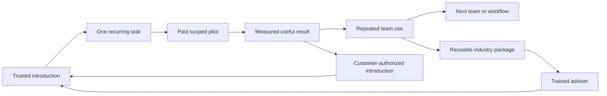

# Distribution strategy: become trusted in a specific working day

3 November 2026 · internal draft · Norway first

## Thesis

The founder's direction is sound: choose a concentrated group of businesses, learn their repeated work, earn a reputation for doing it reliably, and expand through customer relationships and existing industry channels. Product reliability is a condition for this strategy; claiming a superior model is not a distribution advantage.

The initial category for sales is **operational coordination for industrial service teams**. The platform category remains **a governed work environment across company systems, knowledge and working rules**. Keep a shared product core; tailor workflow configuration, terminology, connectors, onboarding and proof to the segment.

Our desired retention comes from useful approved routines, shared case history, reliable integrations and accumulated trust. Give customers usable exports and a clear exit. Retention caused by blocked data or forced dependence would undermine the relationship-led strategy.

## What the reference companies actually teach

| Reference | Supported mechanism | Verevon adaptation | Limit of the analogy |
| --- | --- | --- | --- |
| Toast | Industry-specific platform, field sales, onboarding, support and referrals. [2025 filing](https://www.sec.gov/Archives/edgar/data/1650164/000165016426000057/tost-20251231.htm) | Speak the operator's language; demonstrate one daily job; make onboarding and customer help part of the offer. | Toast also combines payments and hardware. Its economics cannot be copied into an AI workflow subscription. |
| Procore | Invited project collaborators can use the platform without a per-user fee and may later become paying customers. [2025 filing](https://www.sec.gov/Archives/edgar/data/1611052/000162828026011055/pcor-20251231.htm) | Let a useful case bring in an additional colleague; consider scoped external participants later. Price should not punish necessary review. | Invitations are potential exposure, not proven conversion. AI execution still has a cost. |
| Veeva | Industry depth, customer success and sales aligned to distinct business buyers. [FY2026 filing](https://www.sec.gov/Archives/edgar/data/1393052/000139305226000014/veev-20260131.htm) | Know the operations manager's job and the finance/IT buyer's concerns; build repeatable domain templates. | Life sciences means more than pharmacies. Validation, procurement and specialist requirements make regulated pharma a difficult first entry. |
| PTC | Direct sales for large accounts; resellers extend reach into smaller businesses. [2025 filing](https://www.sec.gov/Archives/edgar/data/857005/000119312525291326/ptc-20250930.htm) | After proving delivery, equip a small number of trusted ERP/IT advisers to introduce or implement the same package. | PTC's established engineering software and partner economics differ from an early Verevon pilot. Do not build a CAD product to copy its channel. |

These filings describe established businesses. They support the mechanisms above, not a claim that those mechanisms alone caused historical success or that vertical software is automatically cheap to sell.

## First segment and alternatives

The following is a qualitative hypothesis, not a measured market score. **Access to willing customers and common systems takes priority over this ranking.**

| Segment | Candidate first job | Acquisition route to test | Main difficulty | Decision |
| --- | --- | --- | --- | --- |
| Technical service/maintenance suppliers | Prepare incoming service requests and follow up missing information | Founder introductions, operations peers, ERP/IT advisers | Variation in systems and field practices | First discovery group |
| Industrial equipment/component suppliers | Coordinate order or delivery exceptions | Supplier networks, same ERP advisers | Pricing, stock and order authority | Adjacent comparison group |
| Specialist construction/installation companies | Prepare jobs and document missing information | Trade networks, project collaborators | Existing field software and project-specific requirements | Later adjacency if evidence is stronger |
| Restaurants | Daily operational follow-up | Local owners and POS advisers | Crowded specialist systems; different offer and economics | Do not pursue in parallel |
| Pharma/life sciences | Controlled document or quality work | Specialist consultants | Domain validation, sales cycle and compliance evidence | Defer without a domain lead |

Search scope: 20–200 employees, an identifiable operations/service manager, repeated B2B work, and a coordinator who currently moves information between at least two systems. Company size is a prospecting filter, not the value proposition. Exclude firms without enough repeated coordination to justify the economics.

## The first job

**Trigger:** a service request arrives by email with an order number, equipment reference or attachment.

**Current working hypothesis:** a coordinator finds the contract, previous work and relevant order, checks missing details, assigns responsibility, agrees a deadline and drafts a reply. Interviews must confirm this behaviour and its cost.

**Proposed Verevon result:** one prepared case containing the source references, missing-information list, proposed owner/deadline and reply draft. An authorized person reviews consequential actions. Start with authorized exports and draft outputs if live connectors are unproven; describe that as an assisted pilot.

**Proof:** compare the same task class before and during the pilot, including reviewer time, corrections, exceptions and all delivery cost. Sources being missing or inconsistent should produce a visible exception, not an invented answer.

**Expansion after proof:** more volume of that workflow → another coordinator/team → adjacent delivery follow-up → additional sites → supplier/customer participation if permissions and isolation have been verified. Expand inside the same account before opening another industry.

## Distribution mechanics

**Primary acquisition:** founder-led discovery and a narrow paid pilot. We are buying learning and evidence, not optimizing website signups.

**Secondary acquisition:** trusted industry/ERP/IT advisers with an overlapping customer base. Initially ask for two relevant introductions, deliver the pilot ourselves, then document what an adviser could repeat. A directory listing does not establish a relationship or generate demand by itself. [Visma's partner directory](https://www.vismasoftware.no/finn-din-partner) is a research starting point, not an endorsement of Verevon.

**Internal collaboration:** the coordinator shares a case with a colleague because that colleague needs to review or act. Measure the colleague's useful action and later team adoption. Adding seats is expansion inside a customer; it is not a newly acquired company.

**External collaboration:** later, a customer invites a supplier to resolve a specific missing item. Provide a narrow task, clear sender and scoped access. Keep email/export as an alternative when possible. No forced recipient signup before they receive value. External roles, consent, tenant boundaries, audit and revocation are product work that must pass verification before this loop can launch. [Slack's current model](https://slack.com/help/articles/360035092414-Use-Slack-Connect-to-work-with-other-companies-in-channels) provides a useful permissions reference.

**Referral:** ask after measured value, with the customer choosing whether to make an introduction. Track referred company → qualification → paid retained account. A logo, invite or referral is not a customer until a separate organization pays.

## What to take from Facebook/Myspace and VHS/Betamax

- Facebook expanded from affiliation-based networks before opening more widely. Our inference: serve one dense community of similar operators and their existing relationships before chasing broad reach. Its [2006 announcement](https://about.fb.com/news/2006/09/facebook-expansion-enables-more-people-to-connect-with-friends-in-a-trusted-environment/) does not prove why Myspace lost.
- Sony's [company history](https://www.sony.com/en/SonyInfo/CorporateInfo/History/SonyHistory/2-06.html) discusses VHS manufacturing reach, recording time and available titles. Our inference: integration compatibility, partners and the customer's complete job matter alongside feature quality. This was not simply an inferior product winning through promotion.
- These are mechanisms to test, not evidence that Verevon already has network effects. True cross-company benefit and independent new-customer conversion must be observed.

## Defensibility and customer relationships

Build reusable service-industry workflow knowledge, integration reliability, named customer support, referenceable results and a network of advisers who can deliver the package. Shared templates may use general learning; customer-specific documents, configurations and data remain private unless explicitly authorized for another use.

Customer experience: one named owner, a clear escalation route, a short weekly result review during the pilot, visible failures, exportable work, and a monthly value discussion after conversion. Promise response hours only after assigning coverage. Reliability and useful support are part of the product cost.

## Competition and the main failure modes

Microsoft already markets work-grounded chat, agents and external-data connectors. [Official comparison](https://www.microsoft.com/en/copilot/pricing/business). Procore's 2025 filing also describes construction AI investment and its January 2026 Datagrid acquisition. A traditional industry is not protected from AI competition.

Benchmark the selected task against the customer's present process, existing ERP workflow, Microsoft tools already licensed and a generic AI assistant. Verevon wins only if total task value, integration quality or delivery experience justifies choosing it.

Stop or change the offer if implementations remain bespoke, buyers cannot give access, measured value is below price, the same result is easy in tools already deployed, or ongoing support consumes the subscription margin. Change the workflow or price before buying more traffic.
