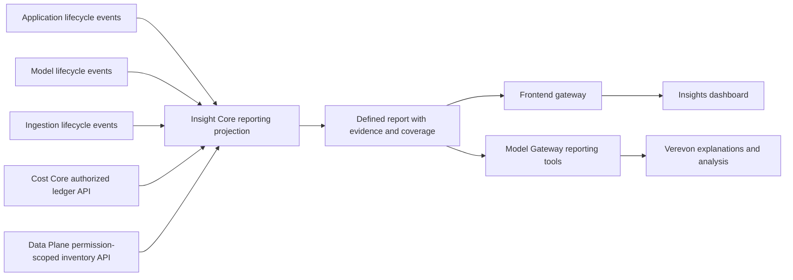

# Insights: trust audit and implementation plan

Audit date: 30 September 2026. Scope: Verevon Insights UI, frontend gateway, Application Plane Insight Core and its producers, Model Plane Cost Core, and the existing Verevon Insights tool.

The audit began as a read-only investigation. Source changes and a local production Compose rollout have since been completed for the current implementation. The runtime architecture uses owner APIs and events, never another plane's database. No database records or credentials were changed, nothing was pushed to GitHub, and no remote production host was updated.

## Implementation started (30 September 2026)

- Cost Core now computes separate metered, subscription, and unknown-basis entry/token totals, plus metered USD spend and the latest entry timestamp. The gateway forwards the selected date window and exposes whether a complete cost-basis breakdown was returned. The authenticated user token remains the authority for personal scope.
- Insights uses the selected date window for Cost Core reads. The AI card is labeled as the signed-in user's usage, never counts subscription calls as billable spend, and reports incomplete/unknown billing basis as partial. Legacy rows are not reclassified.
- The standalone Cost dashboard now calls its total “Metered API spend,” labels entries as subscription, metered, or unknown, and flags unknown historical billing basis instead of calling all rows billed.
- The scorecard names describe recorded ticket-resolution and AI-action review events rather than “conversations handled” or draft acceptance. Empty messages are limited to the selected period.
- The customer-facing Insights page no longer renders the internal connector registry. The `insights_overview` tool output likewise omits catalogue readiness and connector-lag fields that were not proven live health.
- Model Plane's NATS provisioner now declares the two missing durable Insight Core consumers for agent run and approval events.
- Insight Core now separates same-named metrics by unit, includes recorded-event counts and aggregation labels, rejects non-finite values, and explicitly reports coverage as unknown until source checkpoints exist.
- Social provider snapshot identity now includes the organization, does not falsely assign the `count` unit, and uses a snapshot-only upsert so a corrected provider value can replace its prior row.
- Previously stored social provider snapshots labeled `count` are now presented as unverified; the code does not retroactively reinterpret those historical values.
- The Insights client now rejects malformed reports instead of converting missing values into zero, preserves the returned window, and shows partial coverage when the source cannot certify delivery completeness.
- Verevon's Insights tool accepts validated surface and period filters and carries metric provenance and coverage in its bounded response; unverified unit/aggregation values are withheld from model-facing output.
- The same Verevon tool now uses the request's verified user-bound Cost Core bearer to include personal metered spend, Codex subscription entries/tokens, unknown-basis counts, zero-token entries and matching date window. It does not use an internal service credential or infer remaining subscription allowance.

The source changes have been built and tested. Source delivery reconciliation, historical timestamp semantics, evidence drilldown, a provider-reported Codex allowance snapshot, and verified signed-in dashboard parity remain follow-up work.

## Decision

Keep Insight Core as the reporting projection in Application Plane. Make it produce defined, permission-scoped, reproducible reports that both the dashboard and Verevon consume. Repair the evidence pipeline before expanding the dashboard's promises.

The current numbers are backed by stored records, but that alone does not establish the meaning, completeness, reporting period or billing accuracy of a metric. The immediate problem is a combination of incorrect labels, inconsistent filters, missing attribution and a broken agent-event subscriber. A cosmetic redesign would leave those problems intact.

## Verified findings

### 1. The displayed cost is a real ledger sum, with misleading context

The organization matching the screenshot has these stored totals:

| Ledger fact | Verified result |
| --- | ---: |
| Entries | 150 |
| Input tokens | 558,348 |
| Output tokens | 23,867 |
| Stored USD total | 1.9763706, displayed as 1.9764 |
| Entries with positive cost | 117 |
| Entries with zero cost and zero tokens | 33 |
| Entries with an explicit cost basis | 0 |
| Entries with a run ID | 0 |
| Entries with a request ID and idempotency key | 150 |
| First / last entry | 4 September / 23 September 2026 |

The positive-cost entries comprise 101 `claude-sonnet-4-6` entries totaling $1.973418 and 16 `gpt-4o-mini` entries totaling $0.0029526. These sums match the token counts multiplied by the currently stored family rates: $3/$15 and $0.15/$0.60 per million input/output tokens respectively. This verifies the recorded arithmetic; it does not verify provider invoices, the effective rate at invocation time, completeness of usage recording or entitlement treatment.

The 33 remaining entries use several other model names and record no tokens. They cannot be classified as subscription usage from the available evidence. Zero recorded tokens may mean missing measurement; it does not prove a free request.

The dashboard calls all 150 entries “cost-bearing AI requests.” That is incorrect. It also labels the result “Live,” despite the last matching cost entry being on 23 September.

The UI passes the selected window and scope to activity metrics, but calls the cost summary without them. The gateway forwards only the organization to the aggregate endpoint. Cost Core already accepts `since`, `until`, `user_id`, `run_id` and `model` filters, so part of this fix is wiring existing functionality correctly. A rolling seven-day audit query returned one matching entry totaling $0.018843, while the browser continued displaying $1.9764. Exact boundary times must be frozen when reproducing this comparison.

**Scope correction:** an earlier investigation update described this as an organization lifetime total. Current source shows the gateway mints an interactive user token and Cost Core pins user-principal reads to that user. The displayed organization has only one ledger user, so its current total cannot distinguish organization-wide from personal behavior. The certain defect is that the UI selection does not control this request; organization reporting must be explicitly authorized and the response must state the actual scope. Do not weaken authentication to make an organization label appear correct.

Unknown model names can also use the mandatory default rate. The audited positive Claude entries match a configured family prefix, so there is no evidence that this particular total came from unknown-model fallback. Nevertheless, future reports must distinguish exact, family, fallback and provider-reconciled pricing. Legacy records lack enough persisted provenance to retroactively certify their basis.

Evidence: frontend `insights-workspace.ts:31,117`; gateway `domains/cost.rs:125`; Cost Core `internal/server/server.go:346,387`, `internal/server/errors.go:57`, `internal/pricing/pricing.go:108,222`; gateway `audience_tokens.rs:84`; auth-core `plane-token.controller.ts:251`; ledger aggregate database audit.

### 2. Source support is being mistaken for working measurement

The connector endpoint returns a static, organization-independent catalogue. “Native” means an implemented source contract, not a connected, healthy source for this organization. The UI marks a nonempty catalogue “Live.”

Insight Core startup logs on both 29 and 30 September contain:

```text
insight-core: agent subscriber: nats: consumer not found
```

The application and ingestion subscribers bind successfully. The failed agent subscriber prevents that producer leg from starting successfully, while the UI still lists Agents as native. The exact missing durable must be identified against the Model Plane deployment topology; provision it through deployment ownership, not by granting Insight Core stream-creation privileges.

The inspected Insight Core database contains only two metric series, both from conversation-core. No stored agent, chat, social or ingestion metric events were found. Absence of those rows does not prove those products were unused. Ingestion is bound but its delivery/producer coverage still needs reconciliation.

`connector_lag` also describes connector gaps derived from catalogue status; it is not measured queue lag. It must not be advertised as a live ingestion-delay measurement.

Evidence: `insights/pg_repository.go:98`; `consumers/agent_subscriber.go:18,100`; `cmd/server/main.go:92`; `insights/service.go:256`; `insights-workspace.ts:81`; running-container logs and aggregate database inspection.

### 3. Inbox counts measure recorded lifecycle events, not proven workload outcomes

The screenshot showed 6,302 received and 716 sent messages. At audit time the database and settled organization dashboard showed 6,304 received and 716 sent; two additional received records explain the observed change.

All 7,020 stored inbox metric events have empty user attribution. The provider-import path deliberately publishes with an empty actor. The settled “My activity” view therefore has no matching activity records. This is not proof that the signed-in user did no work. Incoming external messages should not be assigned to whichever employee happened to synchronize them.

The publisher timestamps message lifecycle events using `s.now()` at publication, rather than the message's original communication time. Historical imports can therefore inflate a selected period. Initially label these metrics “Messages recorded” or “Inbox imports,” with the timestamp basis explained. Introduce separate original-message time and ingestion time before calling them messages received/sent during a business reporting period.

Message counts are not unique conversations, resolved cases, delivered replies or AI success. The current “Conversations handled” card actually counts ticket-resolution events. Reopened and re-resolved tickets require explicit distinct-entity or transition definitions. The “AI draft acceptance” card uses all approved/rejected AI-action events, without restricting to reply drafts or deduplicating the final decision per draft.

Empty-state copy saying no ticket has *ever* been resolved overstates evidence from a selected window and incomplete delivery pipeline. Use “No verified resolutions recorded for this period” with coverage details instead.

Evidence: conversation-core `internal/conversation/service.go:178,2442,2480`; Insight Core `consumers/metric_subscriber.go:231,254`; frontend `insights-headline-metrics.ts:11,72,105`; aggregate actor and timestamp audit.

### 4. The reporting contract needs stronger semantics

Insight Core currently sums every value sharing a metric name within a surface. It does not enforce aggregation semantics or unit compatibility. Social snapshot ingestion assigns `count` to every provider metric, loses useful dimensional distinctions in the rollup and uses insert-on-conflict-ignore. A corrected provider snapshot for the same key/date cannot replace the earlier value. Snapshot identifiers omit tenant scope, which is a collision risk if upstream account identifiers are not globally unique; no cross-tenant collision was demonstrated.

These rules are acceptable only for carefully defined additive event counters. Rates, balances, current-state gauges and cumulative snapshots need other aggregators. User-visible sums across currencies or incompatible units must be rejected.

The frontend converts malformed or nonfinite numeric fields into zero and malformed overview objects into empty results. This can turn a contract failure into an apparently real measurement. It also discards overview window, generation and per-source timing information. Report loading keys do not explicitly include active organization/session identity; verify invalidation during organization changes and in-flight reads.

Knowledge Insights correctly describes itself as a current, permission-scoped Data Plane snapshot. Its loader does not use the global period or organization/personal selector. Snapshot inventory must have its own clearly stated scope and “as of” time; historical comparisons need historical observations, not invented history.

Evidence: `insights/service.go:87,172`; `insights/pg_repository.go:35,51`; `consumers/metric_subscriber.go:285`; frontend `shared/api/insights-client.ts:105`; `InsightsPage.tsx:161`; `knowledge-insights.ts:23`.

### 5. Verevon access exists, but does not match the dashboard

Model Gateway already exposes `insights_overview`. It calls Insight Core with no period, surface or personal-scope arguments and returns an all-time organization overview. The advertised tool takes an empty parameter object. It returns bounded scorecards, source names and some timestamps, but no Cost Core summary, comparison report or evidence drilldown.

The tool description suggests it can answer “which numbers changed,” although the result has no baseline. Its helper forwards organization identity through an internal application request without a user-scoped reporting argument. This needs deliberate reporting authorization and parity with the UI; organization scoping alone is not enough for personal or role-restricted reports.

Evidence: Model Gateway `verevon_actions.rs:138,320`; `tool_loop.rs:3532,4357`. These are source findings; an AI invocation was not executed or claimed verified during this audit.

## Follow-up: Codex subscription usage

Additional read-only checks confirmed that newer ledger entries can carry `cost_basis=subscription` and zero incremental USD cost. Model Gateway classifies the actual serving provider, so an API fallback can remain metered even if the requested route was a subscription. This is the correct distinction to preserve.

However, reliable subscription consumption is not established. In the first follow-up database sample, across the local installation, 983 subscription-tagged entries existed and 970 had zero input/output tokens. The counts were still growing during inspection. These entries belonged to another organization, not the organization matching the supplied cost screenshot. Missing usage, failures or synthetic responses must be distinguished before interpreting these as measured subscription requests.

Inference Core explicitly accepts absent broker usage and currently defaults absent usage counts to zero (`provider/codex_subscription.rs:214,463`). This loses the distinction between an observed zero and an unmeasured turn. The dashboard summary also exposes only total tokens, total USD and entry count, without a subscription/metered/unknown breakdown.

Add a separate **Codex subscription** section with measured completed requests, reported tokens, missing-usage count, selected dates, effective user/connection scope and last observation. Preserve nullable usage and provider provenance throughout the broker, inference response, usage event and ledger. Do not apply API list pricing to these tokens or call zero incremental USD a free subscription.

Subscription allowance is a separate measurement. Remaining percentage, window duration and reset time must come from the connected account's reported rate-limit snapshot, with account-wide scope and freshness stated. Local tokens cannot determine plan consumption. Integration Core already reads `account/rateLimits/read` in its limit-error recovery path and parses direct-route usage headers; this does not establish a fresh dashboard quota endpoint or a complete historic usage series. A reporting integration should reuse the owner broker contract, not the desktop app's potentially different signed-in account.

Evidence: Model Gateway `pricing.rs:47,60,70`; Inference Core `provider/codex_subscription.rs:214,463`; frontend `shared/api/cost-client.ts:9`; gateway `domains/cost.rs:57`; Integration Core `internal/codexsubscription/appserver.go:284`, `direct.go:673`; local aggregate ledger queries. No provider-account limits were fetched or guessed in this audit.

## A dashboard people can understand

Use a calm overview answering three questions: **What happened? What changed? Where do I need to act?** Keep specialist reports behind clear domain tabs. Do not lead with infrastructure terminology.

Proposed layout:

1. **Insights** — “Your team's activity and results.” Explicit dates, timezone and authorized scope; one compact coverage notice when needed.
2. **This period** — a small set of supported cards. Start with honestly labelled recorded inbox activity and estimated metered AI cost. Add resolved cases, reply-draft acceptance and agent success only when their definitions and producers are verified.
3. **What changed** — server-computed comparison against an equal-length prior period, with a trend chart and sample sizes. Suppress comparative claims when either period has incomplete coverage. A zero baseline should show an absolute change, not an infinite percentage.
4. **Needs attention** — verified source delays, failed runs or imports, unreviewed work and measurable indexing gaps. Each item opens the relevant work or data detail. Do not invent business impact or savings.
5. **Ask Verevon** — questions such as “Explain the AI cost for this period” or “Which imports failed?” carry the exact report/filter context.

Each card opens a detail drawer containing its plain-language definition, dates, scope, current and comparison values, denominator where applicable, breakdown, measurement basis, refresh/coverage status and permission-checked evidence links. Show normal currency precision on the card and exact recorded amounts in details.

Move connector contracts, backend names and supported future providers to an administrator source-diagnostics page. Regular users see actionable language such as “Agent activity is unavailable” or “Messages recorded through 30 September.” Do not hide a material data gap merely because its technical cause lives in settings.

Use separate states for **Measured**, **Estimated**, **Partial**, **Stale**, **Unavailable**, **Not configured** and **No matching observations**. State is metric-specific; a reachable endpoint or recent event does not certify complete coverage. Do not show a measured zero until source coverage supports it.

## Measurement definitions to implement

| User question | Definition and evidence required |
| --- | --- |
| How much work did we receive? | Unique inbound messages or unique conversations by original event time; explicitly distinguish imported history, system notifications and business scope. |
| How many cases did we resolve? | Unique ticket IDs with a defined resolution transition/cohort. Specify treatment of reopening and repeated resolution. |
| Are AI reply drafts useful? | Unique reviewed reply drafts; approved / (approved + rejected), with counts, excluded pending drafts and final-decision policy. |
| Are agents completing their work? | Distinct runs with terminal outcome, original run timestamps and policy exclusions. Cohort by run start or completion consistently; report in-progress runs separately. |
| What is our AI usage/cost? | Metered estimated spend, subscription usage, unknown/unpriced usage and provider-reconciled charges separately. Retain request/run, rate version, effective time, currency, cache categories and attribution completeness. Subscription usage has no incremental token charge in the ledger; it does not establish that the subscription itself is free. |
| Is knowledge ready? | Permission-scoped inventory, indexed/failed/pending states, latest successful source synchronization and freshness policy. Historical change only when historic snapshots exist. |
| What should we fix next? | Explicit counts of actionable failure/review/freshness conditions with links to the owning product. Any AI-proposed priority or cause is an inference, separate from measured facts. |

Do not calculate cost per case or ROI until complete, explainable request-to-run-to-case attribution exists. Imported mailbox history and legacy cost records cannot be assigned inferred actors or verified billing bases just to fill cards.

## Shared report contract and Verevon connection

Both consumers must read the same reporting contract. Implement additive reporting endpoints alongside the existing overview, then migrate consumers without silently changing old metric meanings.



The owner APIs in this diagram are authenticated cross-plane contracts. Insight Core must preserve caller permissions, especially when composing costs and Data Plane inventory. It must never use unrestricted service access to manufacture results the caller cannot read. If permissions differ, return partial sections with explicit reasons.

Minimum report envelope:

- `report_id`, `definition_version`, `generated_at`, requested/effective scope, timezone and an exact half-open `[from,to)` window; explicit prior-period window where comparison was requested.
- Per metric: identifier, definition/version, value or `null`, unit/currency, aggregator, current/baseline sample counts, denominator, completeness and measurement basis.
- Source evidence: source identity/version, event or snapshot watermark, last successful synchronization, known gaps, actor/entity attribution coverage and policy exclusions. Distinguish “no recent activity” from “delivery stopped.”
- Evidence references and a permission-checked drilldown endpoint. A service name is provenance, but cannot by itself explain a displayed aggregate.
- Stable report revision/watermarks, exclusions, cap/withheld counts and typed errors. A malformed payload is unavailable data, never zero.

Add action contracts in `src/shared/actions` and a structured Insights context pack before wiring meaningful user operations. Extend the existing tool with validated period/surface/scope parameters, preserving compatibility, and add report detail and comparison reads. Resolve organization and personal actor from the authenticated session/run; the model must not supply an arbitrary tenant or user ID.

Pass the report reference from “Ask Verevon” so the assistant explains the visible figures. On a new request, fetch an authorized report with the specified filters. Backend code computes totals, denominators, comparisons and price classifications; the model explains them, cites the report and labels hypotheses. It must say when a question exceeds available measurement.

Preserve the existing bounded tool output and Zero Data Retention handling. Retention exclusions must also be visible in coverage. Do not store raw emails, documents or credentials in reporting projections or tool output. Durable saved reports/briefs need explicit retention and permission rules; ZDR data cannot be persisted into a report, memory or export as a workaround.

## Delivery sequence and owners

### Phase 1 — stop misleading claims

Status: initial source changes are in progress as recorded above. They still require validation and a source-to-dashboard reconciliation before they can be considered complete.

**Frontend / gateway / Model Cost Core:** wire exact dates and effective scope through cost summary and entries; return scope explicitly; replace “cost-bearing requests” with defined entry/usage counts; classify legacy basis as unknown; label estimates and stale coverage correctly. Separate subscription usage from incremental estimated spend and billing reconciliation.

**Application / Model deployment:** resolve the logged agent durable failure, verify both run and approval legs independently, then reconcile producer and consumer counts. Expose subscriber failure as degraded reporting health, even while the HTTP endpoint remains reachable. Check retained event history before replay; the Application provisioning script uses a 72-hour stream retention window, so historical coverage cannot be promised from stream replay alone.

**Frontend:** move the registry to admin diagnostics; fix absolute empty-state claims and draft/ticket labels; reject malformed numbers; retain report timing and coverage. Clearly separate inventory snapshots from period-filtered metrics. Invalidate all reporting resources on org/session changes and suppress stale in-flight results.

### Phase 2 — establish trustworthy reports

**Application Insight Core:** introduce a versioned metric catalogue, typed units/aggregators, entity evidence, original/received timestamps, attribution completeness, source delivery checkpoints and SQL aggregation with bounded drilldown. Deduplicate by tenant/source/entity/event identity. Handle snapshot revisions without double counting; distinguish complete snapshots from incremental counters. Validate finite values and accepted dimensions.

**Producer owners:** repair verified delivery/attribution gaps using existing plane contracts and authoritative records. For provider-imported mail, explicitly model mailbox scope and import history rather than inventing an employee actor. Establish durable publication/reconciliation; current conversation publishing logs a publish failure after a successful store, so a successful business write alone does not establish eventual reporting delivery. Backfill only reconstructable facts and mark historical coverage boundaries.

**Model Cost Core:** persist pricing resolution basis, effective catalogue version and ledger revisions; diagnose zero-token records at their producers; establish request/run correlation. Preserve original charges and append corrections or repricing evidence. Provider statement reconciliation remains separate from token estimates; Control Plane keeps billing authority.

### Phase 3 — useful UI and Verevon analysis

**Frontend:** implement the proposed overview, comparisons, breakdown drawers, actionable data notices and report-aware “Ask Verevon.” Hide unsupported outcomes from headline promises while showing relevant measurement gaps.

**Model Gateway:** migrate `insights_overview` to the shared report semantics, add detail/comparison reads and enforce the caller's scope and permitted domains. Test numeric parity with the UI. Start with evidence-based explanations; build suggestions only after report coverage makes them defensible. Delivery of recurring briefs is currently disabled because authoritative recipients are unavailable; do not enable notifications without solving recipient identity/subscription ownership.

## Acceptance tests

1. An exact frozen window yields identical UI and Verevon report values, effective scope, currency and coverage. Cost entries reconcile to the displayed subtotal.
2. Seven-day, thirty-day, personal and organization reads actually change every applicable report component; inventory snapshots explicitly say they are current state. Role/tenant restrictions hold across tools and org switches.
3. A disconnected subscriber, unavailable endpoint, invalid number and truly empty covered window have distinguishable results. Static catalogue entries never establish live measurement.
4. Replays do not double count; corrected snapshots replace the correct scoped revision; cross-tenant identifiers cannot collide; incompatible units and unknown aggregators are rejected.
5. Original event time and ingestion time behave correctly for historical imports, late delivery, timezone/DST boundaries and equal-length comparisons.
6. Draft-only decisions, repeated ticket resolution, retries, in-progress runs and zero denominators follow their declared entity/cohort definitions.
7. Subscription, metered, fallback-priced, unknown-basis, cached and missing-token entries remain distinguishable. Legacy data is never reclassified without evidence.
8. ZDR exclusions, unauthorized domains and output caps remain enforced and are represented as limits on coverage. AI cannot infer access through an organization-only tool.

Existing focused Insight Core tests passed during this audit:

```text
go test ./internal/insights ./internal/consumers ./internal/http
```

These verify current package behavior. They do not prove cross-plane event delivery, billing reconciliation or the proposed report semantics. The logged subscriber failure demonstrates why deployment contract tests and producer-to-report reconciliation must accompany unit tests.

## Open verification items

- Source-owned production checkpoints and source-to-report reconciliation are still missing. Consumer bindings are healthy, but consumer ack progress cannot prove that all source records were published.
- Why do the 33 zero-token legacy entries exist, and how much usage is absent from the ledger?
- Which source-owned records can reconstruct original inbox dates, actor/assignee scope and business outcomes without guessing?
- Are stored provider rates effective and contractually applicable for each audited request? No invoice or current provider rate verification was performed.
- The signed-in dashboard totals and provider-reported Codex allowance still need a browser check after the local user signs in again. The active Codex connection must also return a provider snapshot.
- The repository has substantial uncommitted work and 49 local commits ahead of `origin/main`; those commits and working-tree changes have not been pushed.
- Does existing org-switch handling fully remount Insights, or must its resource keys gain explicit identity revisions?

The first production milestone should be a small number of correctly defined, explained and reproducible metrics. Broader coverage and AI recommendations follow when their evidence is available.

## Follow-up implementation: validation and report contract (1 October 2026)

- Insight Core reports now carry `contract_version: "2.0"`, a plain-language `coverage_detail`, and per-scorecard `definition` text. Coverage remains `unknown` until a source-owned delivery watermark is available; a successful query is not presented as proof of completeness.
- The Insights page now leads with user language (“Your activity”, “This period”, “Source data”), calls complete observations “Measured” rather than “Live”, shows one clear incomplete-coverage notice, and places source names and aggregation jargon under an expandable “About this number” disclosure. Metered spend is explicitly approximate and rounded on the headline card; details retain the recorded ledger amount and separate subscription activity.
- The local production Compose images for the frontend, Verevon gateway, Insight Core, Cost Core, and Integration Core were rebuilt/recreated from the updated working tree. Current checks show the five containers healthy. Insight Core's metric, ingestion, agent-run, and agent-approval JetStream consumers all bind successfully. This confirms service availability and consumer startup, not source completeness or billing-invoice parity.
- Integration Core now has a user-owned `GET /api/v1/model-subscriptions/openai-codex/connections/{id}/usage` contract that reads Codex's `account/rateLimits/read` snapshot without an inference request. It returns provider-reported windows, usage percentages, observation time and valid reset metadata only; it does not expose plan type, provider identifiers or credentials. The Insights UI displays this separately from the Cost Core ledger and never estimates a token allowance. A signed-in provider response still requires an active Codex connection and has not been verified in the browser.
- Delivery completeness is still not reconcilable from Insight Core alone: its subscribers acknowledge JetStream events but do not publish source watermarks/checkpoints into the report. Adding consumer ack position alone would describe subscriber progress, not prove producer completeness. Keep reports partial until owner-plane checkpoints and source-side reconciliation exist.

The Rust context-recovery contract now targets `dispatch_tool_with_cost`, the function that currently owns the `reattach_context` arm, and verifies that the live prompt is still passed to the reattachment selector. Its three focused integration tests pass. The full Integration Core package test still has an unrelated existing direct-request golden mismatch in `TestDirectBodyGoldenRoles`; the changed allowance tests and API contract tests pass independently.

The frontend production image was rebuilt with Docker's `--no-cache` flow. The updated gateway, Insight Core, Cost Core, and Integration Core images were also built and locally recreated. Existing owner credentials were sourced from their local service configuration; no placeholders were left in the running target services. An intermediate Compose attempt rejected incomplete placeholder configuration, which was corrected before verification. The browser session was redirected to login after the gateway restart, so the final signed-in report values and Codex provider snapshot could not be checked. Nothing was pushed to GitHub, and no remote production host was updated.

Validation completed for this follow-up: Insight Core and Cost Core `go test ./...` passed; focused Integration Core provider-usage and API contract tests passed; frontend `pnpm typecheck`, all 293 Vitest files (2,925 tests), and `pnpm build` passed; Model Gateway `cargo test -p model-gateway --lib` passed (1,600 passed, 2 ignored); and the focused Rust context-recovery integration test passed after its stale assertion was corrected. The full Integration Core package suite still has an unrelated stale direct-request golden test failure in `TestDirectBodyGoldenRoles`.
