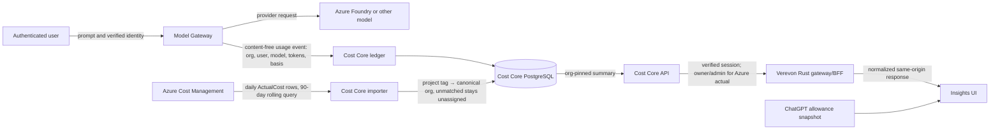

# Azure usage and cost in Verevon Insights

**Current handoff — 2026-10-05:** [Billing, Cost and Insight Core status and future plan](../../../../../../docs/BILLING_COST_INSIGHTS_STATUS_AND_ROADMAP.md). Further implementation is on hold. This guide contains dated integration/deployment evidence; it does not establish complete source coverage or tenant allocation of shared Azure charges. The latest reporting baseline is documented in [the usage analytics guide](polar-inspired-usage.md).

## Purpose

This integration joins three trustworthy views without pretending they are the same measurement:

- **Verevon request usage** comes from Model Gateway/Cost Core request records. It can be attributed to the verified organization and user that made a request.
- **Azure actual charges** come from Azure Cost Management. These are delayed provider billing rows at project/meter/date/currency granularity. They become tenant data only when a Foundry project is explicitly mapped to one canonical Verevon organization.
- **Codex subscription allowance** comes from the ChatGPT provider allowance snapshot. It is an account quota window, not a dollar invoice and not a token-ledger estimate.

This separation makes Insights useful for operations and reconciliation while preventing an estimated token cost, shared Azure bill, or subscription quota from being mislabeled as a tenant's actual spend.

## Request and data flow



The model request path does not send prompts or completions to Cost Core. Cost Core stores accounting metadata and Azure billing evidence, not prompt content, provider secrets, or raw provider payloads. Azure actuals cannot identify a Verevon user; user attribution comes from the request ledger.

## Where the implementation lives

| Concern | Owner and implementation |
| --- | --- |
| Request identity, provider routing, and content-free usage events | Model Plane Model Gateway; org/user scope comes from verified Control Plane identity, never caller-supplied tags |
| Request ledger, Azure importer, org mapping, actual-cost storage and API | Model Plane `go/services/cost-core`; PostgreSQL table `azure_actual_costs`; migration `0007_azure_actual_costs` |
| Azure provider access | Cost Core `internal/azurecost`; service-principal OAuth and Azure Cost Management Query API |
| Tenant authorization and response normalization | Frontend Plane `apps/gateway/src/domains/cost.rs`; same-origin `/api/v1/cost/*` BFF routes |
| Rendering and honest empty/partial/unavailable states | Frontend Plane `src/shared/api/cost-client.ts` and `src/features/insights/*` |
| Organization identity and membership | Control Plane; gateway resolves the active organization from the validated session |

No plane reads another plane's database. The frontend never receives Azure credentials and cannot choose an organization by adding an `org_id` query parameter.

## Azure importer and tenant attribution

Cost Core accepts a narrow subscription or resource-group scope. Configure either `AZURE_COST_SCOPE` or `AZURE_COST_SCOPES_JSON`, never both. It requests daily `ActualCost` for a rolling 90-day window at startup and refreshes every six hours. Successful imports replace the queried scope/date window transactionally so delayed Azure corrections replace stale rows. Throttling and transient failures use bounded request retries and a backoff retry schedule.

The importer reads Azure's `TagKey`/`TagValue` grouping and considers only the exact `project` tag as a Foundry project key. It retains rows without a meter name using `Unspecified meter`; rows with no project tag or no configured mapping remain unassigned. A `project` tag value maps to at most one canonical Verevon org ID via `AZURE_COST_PROJECT_ORG_MAP_JSON`.

Example configuration (placeholders only):

```dotenv
AZURE_COST_TENANT_ID=<entra-tenant-id>
AZURE_COST_CLIENT_ID=<service-principal-client-id>
AZURE_COST_CLIENT_SECRET=<secret-in-secret-store>
AZURE_COST_SCOPES_JSON=["/subscriptions/<subscription-id>/resourceGroups/<rg-a>","/subscriptions/<subscription-id>/resourceGroups/<rg-b>"]
AZURE_COST_PROJECT_ORG_MAP_JSON={"<dedicated-foundry-project-tag>":"<canonical-org-id>"}
```

Grant that service principal **Cost Management Reader** only on the scopes being imported. Keep secrets in the deployment secret store or ignored local environment file; never put real values in source control, docs, logs, or browser code.

### The shared-resource rule

If multiple organizations route through one Foundry project or Azure resource, Azure's charge is shared evidence. Do not map that project to one organization and do not copy its amount to every organization. It can only be allocated under an approved, explicit showback policy based on Cost Core request events, and that result must say “allocated,” not “Azure actual.”

For tenant actual charges, create a dedicated Foundry project per tenant, enforce project selection in Model Gateway using the verified organization configuration, tag it with its unique `project` value, then add that value → canonical org mapping and import. Existing historical charges from a shared project cannot be reliably reconstructed per tenant after the fact.

## API and authorization contract

The browser calls the same-origin `GET /api/v1/cost/azure/actual` gateway route. The gateway:

1. Requires a validated session and resolves the active organization from membership.
2. Requires owner or admin membership for Azure actual charges.
3. Constructs the Cost Core query with that organization ID and passes only supported date filters. It does not forward a browser-provided org ID.
4. Proxies using the gateway's authorized Model Plane credentials and normalizes the response into `{ data, error }` with currency totals and latest usage date.

Auth Core issues `cost:org:read` only after verifying owner/admin membership. Both the gateway role check and Cost Core's signed-scope check protect Azure actuals and organization-wide request totals. Cost Core checks that the signed caller organization matches the query scope. Azure actuals are organization-level, so user, run, and model filters are rejected. A user cannot expand scope by editing URL parameters.

`GET /api/v1/cost/summary` defaults to the signed-in user's ledger (`scope=me`), including for admins. Explicit `scope=organization` requires `cost:org:read` and selects only the signed organization. It cannot be combined with a user filter. The gateway returns the effective `scope` with the normalized summary. In Insights, owners/admins see organization totals in Organization mode and their personal ledger in My activity; other members see their own cost ledger even when viewing organization operational metrics. Decimal metered amounts remain intact in the billing-basis breakdown.

An empty Azure result means that there are no imported rows mapped to this organization for this window. It does **not** mean Azure spend was zero: shared and untagged rows are deliberately withheld. The UI states this directly. Unavailable service/configuration and permission errors are not converted into zero totals.

## Operating and verifying the integration

### Automatic dashboard refresh

Insights re-reads its selected reporting window every 60 seconds while visible. It refreshes the operational overview, scoped request ledger, authorized Azure summary, and the account's Codex snapshot (or knowledge snapshot on the Knowledge tab). This does not force a new Azure billing import every minute: Cost Core imports provider actuals every six hours. Provider billing dates and subscription reset windows remain separate from the UI's **Last checked** timestamp.

The **Refresh now** button runs the same read path. Polling pauses while the page is hidden, skips overlapping reads, resumes on return/reconnect, and removes its timer/listeners when navigating away. Previously loaded data is hidden immediately when the active organization, user, or role changes. An unavailable read retains an explicit unavailable state rather than becoming a zero-cost claim.

Deploy Auth Core before Cost Core and the frontend gateway when changing signed permission scopes. The frontend's bind-mounted Vite source alone does not deploy its compiled Rust gateway; rebuild that service through the authoritative launcher. A production frontend build is also required to verify the shipped bundle.

For local Control Plane recreation, `scripts/run-control-plane.sh` also loads an existing plane-level `.env` after the service files, before generated secrets. This matches the fleet launcher and prevents a single-service Auth Core rebuild from reverting to a stale Dragonfly password. Session verification must be checked after a rebuild; container liveness alone cannot prove cache authentication works.

From the repository root:

```powershell
cd 'apps/Model Plane'
./scripts/compose.sh up -d --build cost-core
docker compose logs --since=30m cost-core
```

Check for `Azure Cost Management daily actual-cost sync enabled` followed by `Azure Cost Management actual-cost sync completed`. If configuration is absent the importer is disabled; if a scope or credential is invalid, startup reports the configuration error without printing secrets. Azure's `latest_usage_date` is the freshest source date, not a real-time freshness guarantee.

Useful verification commands:

```powershell
go test -C 'apps/Model Plane/go/services/cost-core' -count=1 ./...
pnpm --dir 'apps/Frontend Plane/verevonv3' test -- src/features/insights/lib/insights-workspace.test.ts
pnpm --dir 'apps/Frontend Plane/verevonv3' typecheck
```

For a read-only browser smoke check against the already running localhost stack:

```powershell
cd 'apps/Frontend Plane/verevonv3'
node scripts/verify-insights-refresh.mjs
```

This reuses an existing owner/admin Playwright session from the ignored `tests/e2e/.auth/local-state.json`; it does not seed an account or change billing records. Override `INSIGHTS_BASE_URL` and `INSIGHTS_STORAGE_STATE` for another authorized test stack/session. It checks real HTTP responses, manual refresh, a real 60-second timer refresh, scope switching, forged org/user parameters, invalid scopes, runtime errors, and desktop/mobile rendering. Screenshots go to the OS temporary directory. A stale/missing session fails the check rather than silently testing a logged-out page.

Then verify through an authenticated organization owner/admin session in Insights:

1. `GET /api/v1/cost/azure/actual` returns only that active org's mapped totals, with currency and latest date.
2. A member without owner/admin membership receives 403 for Azure actuals.
3. A project mapped to org A is absent from org B's summary; an unmapped project appears in neither tenant summary.
4. The Azure response is distinct from the Cost Core request ledger and Codex allowance panel.
5. The Cost Core health/readiness checks pass and importer logs show a completed sync.

Never use a direct database query as an application integration. For operational reconciliation, use the authorized Cost Core API and the Azure Cost Management portal/export under the same scope and date window.

## Current deployment state and known gates

At the last verified local import (2026-10-04), Cost Core had 462 rows across the two approved resource-group scopes: 324 rows / NOK 125.19 for `Core-Ai-RG`, and 138 rows / NOK 476.91 for `rg-Cloude-ai`. The latest source dates were 2026-10-03 and 2026-09-30 respectively. The first scope included `core-ai` and untagged rows; all rows in the second scope were untagged. **Zero rows are assigned to an organization.** These are resource-group ActualCost totals, not Foundry-only spend; do not present them as tenant Azure totals.

The integration is wired end-to-end, but tenant-specific Azure actuals become non-empty only after dedicated project routing, tagging, and mapping are in place. The locally visible Codex allowance depends on a provider allowance snapshot and can be unavailable independently of the ledger. Azure charges may also be delayed by the provider. Keep these source coverage limits visible rather than filling gaps with estimates.

Before customer billing, approve and version the rate card, shared-resource allocation policy, invoice/credit handling, rounding, and reconciliation process. Before claiming Zero Data Retention, independently verify Azure's configuration and every provider route/fallback; application-side content minimization alone is not proof of provider-side ZDR.

### Historical coverage is a source fact

Automatic refresh does not reconstruct metadata that was never recorded. Historical ledger entries without a billing basis remain unknown until an authoritative provider/request match establishes it. Missing token counts cannot be treated as free requests. Insights displays recorded request counts and known metered subtotals separately; it does not show an invented `$0.00` total for an unknown-only ledger. Operational events stay observed/partial until their producers supply delivery checkpoints. Empty tenant Azure actuals stay empty while the shared imported rows are unassigned. These are disclosed data limits, distinct from an HTTP failure or an unrefreshed UI.

### Local runtime verification — 2026-10-05

Auth Core, Org Core, Cost Core, Verevon's Rust gateway and frontend were rebuilt/recreated and confirmed healthy. Org Core's deployed service registry now includes Auth Core's existing `org:retention:read:any` contract; omitting it had prevented privacy-aware cost token issuance. The cache environment mismatch was also corrected without rotating sessions or disabling authorization.

The read-only browser check passed against `http://localhost:5173/insights` using the existing owner test session: 14 relevant page API responses were HTTP 200, manual refresh changed Last checked, a real minute timer re-read the data, My activity selected the personal ledger and hid Azure organization charges, and Organization selected the organization ledger. Forged org/user query values did not change the authorized aggregate; an unsupported global scope returned 400. Azure actuals returned 200/configured with no mapped tenant rows. The desktop page displayed 1,559 recorded requests and a separate provider Codex allowance snapshot. No JavaScript or console errors occurred in the tested flow. These test-org values are not Aquatiq totals or guaranteed current values.

At 390×844, the navigation drawer was dismissed through its exposed backdrop, the refresh button remained within the viewport, and a mobile refresh also updated Last checked without JavaScript errors. Desktop/mobile screenshots are temporary test evidence, not repository fixtures containing customer data.

Focused validation passed: Cost Core's complete Go suite, Auth Core's role/token tests (52 tests), Org Core HTTP/org tests, gateway cost regressions (6 tests), frontend scope/metric/refresh tests (25 tests), frontend typecheck/lint and production build. Existing bundle-size warnings remain advisory.

## Verified support outcomes and user reports

The public Insights read now asks Conversation Core for a fresh owner-record snapshot before requesting the Insight Core overview. Conversation Core owns and queries its own tickets and review decisions; the BFF uses its existing signed organization delegation. Insight Core accepts the snapshot only through its internal, key-protected endpoint and validates organization, personal actor, exact date window, source, freshness, and nonnegative counts. A failed owner read falls back to observed events without claiming verification. No other plane queries Conversation Core's database.

Three scorecards use `owner_record_count`, `coverage: measured`, and `checked_at`. Resolved tickets are distinct retained tickets **currently** resolved/closed whose latest resolution timestamp is in the window; reopened tickets are excluded. Personal ticket scope uses the **current assignee**, not a guessed historical resolver. AI approvals/rejections count saved decisions in the period, with personal scope filtering the reviewer. A successful source query can verify zero tickets. Zero review decisions cannot produce an approval percentage. Other activity series remain observed because this snapshot does not prove their event delivery completeness.

Owners/admins can read `GET /api/v1/cost/users` for the active organization and selected window. Cost Core requires the signed `cost:org:read` permission; the BFF independently verifies membership and forwards only dates plus the canonical organization. The grouped database query includes the entire window without a raw-entry limit. Each row separates metered API estimates, subscription request counts, measured tokens, and missing metadata. Unattributed automation remains a separate row; no missing user is guessed. Names come from the organization's authorized member roster. Personal mode hides the team report and uses the existing self-scoped ledger. Browser-supplied organization/user selectors cannot expand either scope.

### Durable accounting delivery

Model Gateway now requires a JetStream storage acknowledgement for canonical `mp.v1.usage.*` events. `MODEL_PLANE_USAGE_EVENTS` retains content-free envelopes for up to seven days, subject to its 256 MiB limit. A provisioned `cost-core-usage` durable retries failed writes, acknowledges successful/idempotent writes, and terminates malformed envelopes. Runtime Cost Core can inspect/bind/ack this exact consumer; it cannot create streams or consumers. Zero Data Retention envelopes are excluded from this retained stream.

Replay preserves the producer timestamp (or the stream timestamp for legacy envelopes), so a retry does not move old usage into today's reporting window. Migration `0008_erasure_replay_guard` stores an irreversible organization hash. Ledger ingestion and erasure share an organization advisory transaction lock; queued deliveries cannot recreate erased usage, while other organizations continue recording. This is an accounting replay guard, not a claim that every provider satisfies ZDR.

A configured usage broker is authoritative. Cost Core retries connection and consumer binding every five seconds if NATS or the provisioner is not ready, rather than permanently disabling accounting while its HTTP endpoint remains healthy. Once bound, the NATS client reconnects indefinitely. Shutdown cancels the startup retry promptly. An unset `NATS_URL` retains the explicit legacy file-feed behavior; a configured broker failure never silently switches to that feed.

Provision NATS before deploying the changed consumer/publisher. The canonical Model Plane compose launcher now includes that dependency. When changing the bind-mounted NATS ACL, reload/restart the broker, run the provisioner, then recreate Cost Core and Model Gateway. Never delete JetStream data or reset the ledger to repair reporting. Contract tests exercise the deployed ACL, offline delivery, negative acknowledgement, rebinding, and least-privilege permissions.

This closes the ordinary consumer-restart loss window. It does **not** reconstruct preexisting billing basis/token/user metadata or promise delivery beyond stream retention/capacity. A publish that fails before storage acknowledgement still needs producer retry/reconciliation; there is no new persistent producer outbox in this change. Shared Azure invoices remain unallocated until provider-specific metering and an explicit allocation policy can establish each tenant's share; Codex usage must not be included in an Azure token allocation.

The browser verification now checks owner-record provenance, reconciliation of user rows against organization ledger counts/billing bases, personal-mode isolation, forged selectors, manual refresh, the real minute refresh, and desktop/mobile rendering. The Go tests additionally cover source scope/freshness rejection, complete per-user aggregation, durable restart/redelivery, and erasure replay isolation.

### Deployment recovery — 2026-10-05

Docker Desktop recovered after the engine interruption. Cost Core and Model Gateway were rebuilt and recreated through the canonical Model Plane launcher. Both are healthy; Cost Core logs confirm an active durable usage subscriber, active organization-erasure consumer, and a completed Azure import. NATS reports the provisioned `cost-core-usage` consumer bound to `MODEL_PLANE_USAGE_EVENTS` with no pending or unacknowledged deliveries at verification. This is a readiness observation, not evidence that a new billable inference was generated by the test.

The real PostgreSQL 16 integration tests passed against disposable databases: Cost Core's complete integration suite verifies idempotency, billing-basis round trips, per-user aggregation, and erasure/replay isolation; Conversation Core's outcome test applies its real migrations and checks two tenants, different assignees/reviewers, reopened tickets, and inclusive-start/exclusive-end date boundaries. No synthetic tickets, usage, or billing rows were added to the live source databases. Use `COST_CORE_TEST_DATABASE_URL` or `CONVERSATION_CORE_TEST_DATABASE_URL` only with an isolated test database for these suites.

The Model Gateway Dockerfile cooks only the gateway package, defaults to two compiler jobs, and uses a dedicated Rust 1.97 build-cache namespace. This avoided reusing artifacts interrupted during the engine failure without deleting shared caches or data. The Linux release image completed successfully. Focused Model Gateway publisher tests, gateway Insights scope tests, Conversation Core source scope/error tests, Insight Core provenance tests, Cost Core and NATS provisioner Go suites, frontend tests, typecheck/lint, and the production frontend build passed.

After recovery, Auth Core, Org Core, Conversation Core, Insight Core, the Rust BFF, and the frontend were confirmed healthy. The browser test signs in only when the existing local test session needs renewal, using the already provisioned account; it does not create organizations or change the user's SSO session. Docker's Windows bind mount missed a source edit notification: the files inside the container were current but Vite's transformed CSS was stale. Restarting only the frontend invalidated that cache. The Insights metric section now places the coverage notice above its own metric grid, and the user report scrolls horizontally inside its card with readable user identifiers on narrow screens.

The final read-only browser run passed with 18 relevant HTTP 200 responses, no JavaScript/console errors, manual refresh, a real 60-second automatic refresh, personal/organization scope switching, and rejection or neutralization of forged scope selectors. Three support scorecards carried fresh Conversation Core owner-record provenance. Summed per-user request counts and billing-basis counts matched the organization ledger. Layout checks passed at 1440×1000 and 390×844, including a compact coverage notice and a user table that scrolls inside its card without widening the page. Azure actuals returned HTTP 200/configured with no tenant mappings; no invoice allocation was invented. The local account's Codex provider snapshot loaded separately.

The Model Gateway logs also contain an independent, preexisting fine-tuning poller credential rejection (Auth Core 403). Its background task is separate from usage publishing and the successful Insights reads; this verification does not certify fine-tuning operations. The test did not initiate a paid provider request, so production inference-to-ledger reconciliation remains a separate check using an authorized real request and its request identifier.

### Fresh organization usage periods — 2026-10-05

An organization can start a new **AI usage reporting period** without deleting accounting history or forgiving budgets. Migration `0009_usage_reporting_periods` stores an operator-audited start timestamp, organization, requester and reason. The latest start date is read by Cost Core after verified tenant/user scoping. The BFF always selects `reporting=current` for the dashboard summary; the per-user dashboard report uses the same baseline. Requested date windows are intersected with that baseline. Other organizations, billing/budget aggregates, raw ledger records, Azure invoices, provider subscription limits, and operational ticket/message metrics retain their original meaning. Organization erasure also removes its reporting-period metadata.

This is an operator operation, not a public browser-write endpoint. Verify the canonical organization through Control Plane's owned records before adding a period through Cost Core's own database. Record the requester and reason, use the database clock, and make retries idempotent for the same authorized operation. Never use a usage reset to erase charges or hide newly missing measurements. An absent/failed baseline read cannot be interpreted as a successful zero report. Historical entries remain available through the authorized ledger APIs.

Aquatiq AS's authorized reset was applied at **2026-10-05 01:15:20 UTC (03:15:20 Europe/Oslo)**. The 152 existing ledger records were counted before and after the operation and retained unchanged; the new period initially contained zero requests. Two real browser verification requests then completed successfully: a Codex subscription request recorded 6,241 input / 5 output tokens and an Azure OpenAI metered request recorded 4,768 input / 1 output token, with an API estimate of USD 0.0007158. Both retained the verified organization and user, and both carried an explicit billing basis. These two real verification requests belong in the new report; they are not synthetic ledger inserts. The Azure amount is a request-ledger estimate, not a reconciled invoice total.

The production UI now shows request counts consistently, short descriptions, the reporting start date, named current-user usage, and concise availability notices. Technical delivery explanations and implementation names are removed from the primary UI. Optional data-coverage information remains collapsed, and genuinely missing future cost details still produce an honest short notice. Sub-cent positive API estimates display `< $0.01`, avoiding a misleading zero. User reports refresh even with the **All** time filter.

Validation covers baseline isolation between tenants and users, pre-baseline exclusion, retained history and budget enforcement, database migrations, and removal of baseline metadata on erasure. Real PostgreSQL integration tests and the focused frontend metric tests pass. The live browser confirmed the reset and successful provider-to-ledger attribution for both billing types.

## Why this design

Follow-up: [Polar-inspired usage reports and second reporting reset](polar-inspired-usage.md) documents the 03:28:59 Oslo baseline, input/output meters, grouped analytics, export and remaining billing-provider work.

- **Trust:** every number identifies its source and measurement basis; unknown or missing data is not silently converted to zero.
- **Tenant isolation:** an org sees only explicitly mapped project actuals; identity and access decisions are server-side.
- **Privacy:** model prompts are proxied through Model Gateway and excluded from the cost ledger; provider credentials remain server-side.
- **Reconciliation:** provider invoices, request metering, and subscription allowance can be compared without conflating their units or authority.
- **Operational clarity:** scope, latest source date, empty/unavailable states, and retry behavior are visible and documentable.

Related detail: [Azure Cost Management setup](azure-cost-management.md) and [tenant metering and privacy](tenant-metering-and-privacy.md).
