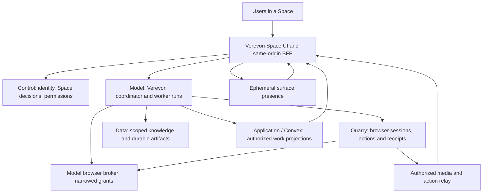

# Visible agent teamwork in Verevon Spaces

**Decision proposal, 4 November 2026.** Prepared from the supplied `klipp.mov`, current public product documentation, and a read-only source audit of CoreSystem `main` at `9bea43473766373bdeb32299329fb52f1e2c6fc2`, including existing local changes. Selected Model Plane paths were also compared with `model-plane` at `c5ebdc679` and `mp-w2w3` at `8188a6ea1`. This is a plan, not an implementation or certification of the running stack. No services, flags, permissions, or product code were changed.

## 1. Recommendation

Build a **visible agent workspace inside each Space**. Verevon coordinates a small team of named assistants; users see their actual browser sessions, current actions, deliverables, and requests for help. Users can follow an assistant, steer its task, pause it, or take control of its browser.

The concept is feasible with your architecture. Much of the underlying browser and agent machinery already exists. The missing work is chiefly the connection between execution identity, Space authorization, live observations, and a coherent collaboration surface. It is more than drawing cursors.

Use three complementary surfaces:

1. **Team overview:** who is working on what, dependencies, progress, and attention needed.
2. **Live work surfaces:** real browser tiles, documents, code changes, or API activity; expand one to follow it closely.
3. **Shared result:** the page, report, comparison, or workflow the team is building, with attribution to accepted changes.

Start with one coordinator and two workers, each worker using an isolated Quarry session. Multiple users may observe explicitly shared sessions. One controller operates each tab. Several cursors may point or annotate, but they do not confer simultaneous input ownership.

For agents building the same website, use coordinated code/document edits and a live preview. That is a different execution problem from several agents browsing existing websites; both can inhabit the same Space.

## 2. What the clip demonstrates

I inspected 14 chronological frames across the 25.6-second clip, with no audio transcription. Times below are approximate samples:

- Around 0–4 seconds, colored cursors spread from the logo, text appears, and rectangles identify work targets.
- Around 5–9 seconds, multiple parts of the page appear in parallel, with selection boxes, dimensions, and typing indicators.
- Around 11–24 seconds, scrolling reveals more work; the same visual actors move between sections.

The useful qualities are spatial attribution, visible partial results, simultaneous activity, and continuity of identity. Rulers and dimension labels are useful for design work but would be noise during an invoice or support task.

Swarm Rebuild's source describes DOM snapshotting into a blueprint, then a separate reconstruction layer with choreographed cursors. The page's scripts are not running inside that reconstruction. Its README also says there is no license yet and credits adapted animation code. Use the interaction idea; implement your own renderer rather than copying its engine. [Extension source and licensing notes](https://github.com/DhvanilPatel/swarm-cursors/blob/main/README.md), [implementation](https://github.com/DhvanilPatel/swarm-cursors/blob/main/swarm-rebuild/swarm.js).

For Verevon, a cursor must represent a real participant and an actual work target. Interpolation between observed points is presentation. An invented click, typing sequence, or success would misrepresent execution. While a model is planning or waiting for a response, show that state rather than keeping its cursor artificially busy.

## 3. External concepts worth learning from

These are documented capabilities and product claims, not hands-on evaluations or proof of performance. Sources were checked on 4 November 2026.

| Product / framework | Existing concept | Implication for Verevon |
|---|---|---|
| [Warmwind](https://about.warmwind.com/warmwind-launches-international-rollout-of-autonomous-ai-workers/) | Describes isolated cloud computers for workers, parallel work and scheduled execution. | Good worker/environment model. Public material reviewed does not establish a Miro-like shared swarm surface. |
| [Heyclicky](https://www.heyclicky.com/) | On-screen assistance, drawing on the screen, and agents that perform tasks. | Learn from contextual pointing and approachable interaction. It does not establish the enterprise Space coordination model you need. |
| [Grok Bot](https://x.ai/bot) | Multiple bots, shared context, handoffs, computer use and teaching routines. Its FAQ says bots share a persistent computer per user. | A close product comparison. Verevon should make shared work, accountability and audience boundaries explicit, rather than assuming one user's machine is the team's environment. |
| [Browserbase Live View](https://docs.browserbase.com/platform/browser/observability/session-live-view) | Embeddable live viewing, input and per-tab views. | Live browser visibility already exists. Use as a benchmark or Quarry-backed adapter, not a second authority path. UI-only read-only controls are not sufficient authorization. |
| [Steel Live Sessions](https://docs.steel.dev/overview/sessions-api/embed-sessions/live-sessions) | Documents headful WebRTC streaming and human interaction; warns that debug URLs grant access to their holders. | A transport reference. Verify actual deployed APIs and access controls before adopting a provider; never expose provider credentials or raw session capabilities as room metadata. |
| [Browser Use](https://browser-use.com/cloud-browser) | Remote browser sessions with live viewing and takeover. | A useful comparison for agent/browser operations; the review found viewing already present, so the gap is broader team UX. |
| [LangGraph](https://docs.langchain.com/oss/python/langgraph/workflows-agents) | Orchestrator/worker patterns, state, streaming; [interrupts](https://docs.langchain.com/oss/python/langgraph/interrupts) support persisted human intervention. | Study scheduling and interruption semantics. These do not supply Quarry's browser safety or a multiplayer work surface. Keep the existing Model runtime as owner. |
| [OpenHands delegation](https://github.com/OpenHands/software-agent-sdk/blob/main/openhands-tools/openhands/tools/delegate/definition.py) | Explicit spawn/delegate operations with named agents and tasks. | A useful delegation contract reference; not a reason to add another production execution authority. |

The opportunity is not the first visible browser agent. It is a **shared, understandable team of agents connected to the company's work and knowledge**, where users can see evidence, intervene, and keep working alongside it.

## 4. What CoreSystem already has—and what it does not

File paths below are relative to `C:/dev/CoresSystem`. Code presence is implementation evidence, not proof of enablement or live behavior.

| Area | Existing source | Required change |
|---|---|---|
| Quarry live browsers | REST/SSE/WebSocket frames and actions; `apps/Ingestion Plane/Quarry-v2/crates/quarry-edge/src/agent_routes/ws.rs:38`, `live.rs:124`. | Shared audience authorization, scalable fanout, aligned action/viewport telemetry. |
| Human/agent coexistence | Agent attachment opens a background tab with an independent observation lane; `agent_routes/attach.rs:103`, `types.rs:60`. | Attachment supports only one live delegate per run (`attach.rs:193`), is default-off, and refuses ZDR. Use separate runs first. |
| Input ownership | Per-tab holder/epoch control and takeover; `agent_routes/tab_ledger.rs:39`. | Preserve server enforcement; extend verified actor provenance and reconciliation across restarts. |
| Cursor target events | `quarry-core/src/event.rs:124` has presentation-only target rectangles. | `quarry-runtime/src/observation.rs:413` always emits `rect: None`. Implement resolved-target geometry and version alignment. |
| Model delegation | Real delegated child lineage and execution; `apps/Model Plane/rust/services/execution-core/src/runtime_loop/agent.rs:6245`. | Children execute steps under the parent's request/run (`:6292`, `:6335`) and receive no browser bearer (`:6347`). A browser worker needs an independent execution identity/session/grant. |
| Space browser invocation | Browser tools exist for eligible personal runs. | `agent.rs:1388` explicitly excludes Space-scoped runs. Removing this condition alone would bypass missing authority and identity work. |
| Browser recovery | Browser run lifecycle and events exist. | `apps/Model Plane/rust/services/model-gateway/src/browser_run.rs:69` rejects durable approval continuation; `:1805` notes missing dispatch marker, `:2156` spawns in-process work, `:2176` uses empty Space ID. Do not confuse general approval support with this path being resumable. |
| Space agents | Application creates definitions/bindings and stable service subjects; `apps/Application Plane/convex-core/convex/spaceAgents.ts:460`, `:506`, `:1016`. | Connect authorized agent identity to browser execution; a participant row is not a browser grant. |
| Space live work | Room-safe run streams and cards exist; `apps/Frontend Plane/verevonv3/src/shared/api/space-run-live-client.ts:11`, `src/features/spaces/lib/space-run-store.ts:33`. | Add work-surface references and actor events. Current live run subscriptions cap at three; audit this alongside actual worker caps. |
| Presence | Online/typing with 30-second presence TTL; `apps/Application Plane/convex-core/convex/spacePresence.ts:42`. | No surface pointers or high-frequency awareness transport. Agent liveness must come from runtime heartbeats, not a viewer being online. |
| Browser UI | `apps/Frontend Plane/verevonv3/src/features/dashboard/home/BrowserChrome.tsx:588` supports WS → SSE → polling; takeover controller uses expected epochs. | Extract/reuse session-scoped viewer behavior for Space surfaces, isolating tile render failures and control ownership. |
| Collaborative artifacts | Persisted artifact versions plus sender-local live output; `src/features/spaces/lib/room-live-artifacts.ts:1`. | No collaborative editor/CRDT found. A page preview needs revisioned patches and merge rules, not just presence. |

Selected Model branch comparisons retain the Space exclusion, child bearer restriction and standalone continuation gaps. This report does not audit every file on every branch.

## 5. Architecture and ownership



- **Control:** authoritative humans, service identities, Space membership, recipient audience, effect decisions, privacy and quotas. Re-check authority on effect, resume and sharing changes.
- **Model:** coordinator, task graph, worker lifecycle, planning, tools, budgets, durable approvals, run lineage and its existing generated run artifacts/drafts. Existing Session Core/orchestration owns execution state; do not recreate it in Convex.
- **Quarry:** actual browser sessions, observations, action validation/execution, screenshots/media and control fencing. It does not become another reasoning runtime.
- **Application/Convex:** Space aggregate, assistant definitions/bindings, authorized activity projections, work-surface metadata and coarse presence. It is not the browser lock or the durable agent scheduler.
- **Data:** authorized retrieval, published durable knowledge, document/canvas versions and source references. Promoting a Model run artifact to a Data canvas/knowledge asset is an explicit authorized operation; existing run artifacts do not silently change owners. Do not add a second knowledge database in Convex.
- **Frontend/BFF:** views, controls, smooth overlays, scoped subscriptions and typed actions; no provider secrets in client metadata.

Keep the existing WS20 C1 decision that browser grants remain Space-free. Bind the exact Space/run/agent/grant combination in trusted server-side state with a current Control decision. Quarry validates the browser capability, actor and control epoch. A Space ID in client JSON is never authority. If a future requirement demands broker-level Space fields, make that an explicit contract decision rather than quietly contradicting the existing plan.

### What Verevon knows

Verevon has a live index of authorized Space goals, tasks, assistants, resources, dependencies and result references. It retrieves relevant evidence as needed and asks workers for structured progress/results. It does not load all company data into one prompt or see private browsing merely because it supervises the team.

Maintain a task record with owner, goal, dependencies, scope, budget, expected result, acceptance criteria and artifact/source references. Distinguish a persistent assistant definition from an ephemeral worker instance. Verevon may propose/create permitted worker instances within the task budget; installing a permanent assistant or granting new tools follows the existing governed agent-creation flow.

## 6. The intended experience

Example: “Compare these three suppliers, check our purchasing requirements, and prepare a recommendation.”

1. Verevon proposes a short division of work in the Space. The user can adjust it; routine work can begin under previously granted policy without approving each click.
2. Two assistants open independent shared research browsers. Verevon checks internal requirements through authorized retrieval. Each work surface names the assistant and its task.
3. The overview shows real browser thumbnails, last update time, current step and state. Selecting one opens a focused view. Following another agent changes the viewer's camera, not that agent's selected tab.
4. A small cursor/target highlight appears when an actual browser action is resolved. A completed action flashes briefly only when Quarry confirms it. Reading/retrieval appears as a source or document activity, not fake mouse movement.
5. Users can point to an element and send “check this,” steer the task, or request control. Pointing is advisory; it is not an input command. The agent re-observes a referenced target before acting on it.
6. If login, CAPTCHA, approval or uncertainty blocks a worker, its tile raises a hand. Other workers continue if independent.
7. Results arrive in the shared comparison artifact with evidence links. Verevon reconciles disagreement and reports outstanding gaps. Completion means the acceptance criteria were checked, not merely that the model stopped generating text.

Minimum surface controls: Follow, Pause, Take control, Give back, Stop, and an attention request. Separate read permission, task steering, browser input, and effect approval. A room viewer does not acquire input permission by pressing a button.

Default overview should be calm: two to four visible surfaces, one focused, the rest as thumbnails. Stable actor names/colors; text labels and shape/state cues in addition to color. Keyboard access and a low-motion mode should retain every action/status. Idle cursors fade. No cursor flocking over unrelated UI, fabricated progress percentages, or forced auto-scroll. Replay is explicitly labeled and separate from live execution.

### Building one page together

A browser does not author durable source code simply because its DOM changes. For a website-building task:

- Model assigns files/components/sections to workers in isolated work areas.
- Workers submit patches with a base revision, affected resource IDs, tests and a brief change summary.
- An integration lane validates/merges patches, builds the preview, and emits the accepted revision plus author/change bounds.
- The shared preview highlights the actual changed component. An assistant cursor may point to it, with “updated hero section” and a link to the patch.
- Conflicting edits go through explicit merge/review. Browser automation then tests the resulting page in Quarry.

For a structured design editor owned by Verevon, use typed object operations against stable IDs. This can support concurrent editing more directly. Arbitrary third-party pages do not provide the same collaboration semantics. The existing WS19 canvas uses compare-and-swap versions; adopting CRDT co-editing later requires a deliberate protocol/ownership extension while Data remains the durable content owner.

## 7. Browser concurrency, control and recovery

**Parallel sessions first.** Each active worker gets a separate run/session, narrowed domain and tool permissions, budget, and attributable receipts. This fits Quarry's existing one-delegate-per-run limit without expanding that limit prematurely. Separate contexts do not automatically provide authorized independent logins: profile selection and credential use need their own scope.

**One controller per tab.** Use the existing control epoch as a fencing token. On takeover, stop admitting old-epoch agent actions, settle any action already executing, report its actual outcome, and only then acknowledge human control. Give-back requires a new observation. An observer's pointer never enters the control lane. “Pause” and “Stop” are acknowledged backend states, not just disabled animations.

**Account-level collisions still matter.** Two isolated browsers can both change the same external record, draft or cart. Model needs task/resource reservations or conflict policy keyed to the external account and affected resource. Use provider idempotency keys where supported and explicit write verification. Browser input is not an exactly-once transaction: a lost acknowledgment after Submit becomes an unknown outcome to reconcile before retrying.

**Do not copy the coordinator's bearer to children.** Existing children are denied browser access for a reason. Add an independent browser execution identity and narrowed grant per child, retain parent lineage/cost attribution, and remove child credentials at completion/cancellation. Reconcile run/session allocation with idempotent start requests, a durable dispatch marker and compensating cleanup for partially created resources.

Partition budgets before dispatch. The current ad hoc delegation path can claim all remaining rounds (`execution-core/src/runtime_loop/agent.rs:5182`); the existing research fan-out scheduler already divides work and is a better starting point for fair sibling admission. A queued worker should visibly remain queued rather than consuming browser resources while waiting for a model budget.

**Restart honestly.** Persist tasks, decisions and allowed receipts; live DOM/browser state remains a separate, fallible resource. A browser restart creates a new session incarnation. Mark the surface reconnecting, reauthorize, re-observe, and verify external effects before proceeding. Never play cached frames as if the worker is still live.

**Shared authenticated browser later.** Multiple delegates in one browser context may be useful for deliberate handoffs. They require an identity-keyed attachment registry, independent observation lanes, per-tab fencing, and cross-tab account conflict handling. Tabs share cookies/storage and are not security isolation. Simultaneous same-tab typing is not an initial requirement.

## 8. Honest live telemetry and media

Extend existing event contracts instead of introducing an unrelated animation event source. Suggested fields below are a design sketch, not claims about current wire schemas:

```text
WorkSurface: surface_id, space_ref, kind, agent_subject_id, agent_instance_id,
  parent_run_id, run_id, browser_run_id?, tab_id?, session_incarnation,
  visibility, audience_revision, control_holder, control_epoch, status

ActionObservation: event_id, producer_seq, action_id, run_id, surface_id,
  tab_id, session_incarnation, snapshot_id, viewport_epoch, frame_seq?,
  event_kind, occurred_at, public_summary, target_rect?, outcome?, evidence_ref?

FrameEnvelope: surface_id, tab_id, session_incarnation, frame_seq,
  captured_at, viewport_epoch, layout_revision, css_width, css_height,
  pixel_width, pixel_height, device_scale, mime_type, payload
```

Authoritative IDs come from verified server bindings. Cursor labels/colors are display metadata. Public summaries describe actions, results and stated purpose; they are not a dump of private model reasoning, raw prompts, credentials or tool payloads.

Resolve target bounds from the actual verified action target immediately before dispatch. Carry CSS viewport dimensions, device scale, frame/scroll transform and navigation/layout epoch. Map to the displayed video rectangle, accounting for letterboxing and scaling. Discard/fade a target overlay after navigation, tab switch, stale frame or mismatched incarnation. For cross-origin iframes use Quarry's frame-aware driver data; if geometry cannot be verified, show an action label without inventing a location.

Add an authorized, read-only **tab-addressed media subscription**. The current WS path uses the session handle (`quarry-edge/src/agent_routes/ws.rs:36`), and live capture reads its current tab (`quarry-browser/src/chromiumoxide.rs:5046`). Following a background agent tab must pin the capture target; it must not call select-tab or redirect the worker's execution focus. Test this with two viewers following different tabs. The current frame envelope lacks the proposed capture/tab/version fields; measure freshness from actual capture time, not gateway forwarding time, and correlate target overlays to matching frames.

The minimal visible lifecycle is `queued → observing → planning → acting → verifying → completed`, with explicit `waiting_for_user`, `blocked`, `paused`, `reconnecting`, `failed`, `cancelled`, and `outcome_unknown`. Aggregate task progress and browser action progress remain distinct.

Browser progress publication is currently best-effort (`apps/Model Plane/rust/services/execution-core/src/browser_events.rs:12`, `:141`). Detect sequence gaps, deduplicate repeated events, and reconcile against authoritative receipts/snapshots before claiming completeness. Use per-producer ordering plus causal action IDs rather than assuming one globally ordered clock. Lost pointer updates can be dropped; a missing action result cannot be converted into success. Disconnected viewers recover the latest state and a bounded event history allowed by retention policy.

Use three delivery paths:

| Data | Transport / durability |
|---|---|
| Tasks, approved results, coarse participant/work state | Existing Model records and authorized Convex projections, with idempotent event application and replay cursors. |
| Action targets, pointer awareness, viewport changes | Bounded ephemeral channel, sequenced per producer/surface; drop obsolete positions, interpolate locally. |
| Browser pixels | Quarry media producer through an authorized gateway/relay, independent from Convex document writes and from action execution. |

Current Quarry streams sample JPEG/PNG base64; default interval is 250 ms, and each capture starts/acks/stops CDP screencast. In the WS path a long action is awaited in the frame-delivery loop. First separate media production from action handling, use one producer per tab, bound queues, fan out the latest frame, and adapt focused/thumbnail rates. Evaluate continuous screencast and then WebRTC against measured need; a protocol change alone will not solve capture cost or authorization.

Illustrative load, **not a benchmark**: four sessions × four frames/s × 100 kB/frame = 1.6 MB/s before base64; roughly 2.13 MB/s after it, before additional overhead and viewer fanout. Do not send every tile at maximum quality or write video into Convex. The official [Convex presence guidance](https://stack.convex.dev/presence-with-convex) also distinguishes coarse presence from high-frequency cursor updates and recommends an in-memory approach for the latter.

Provisional pilot targets to measure: action event to observer p95 under 500 ms in the chosen region; focused frame age p95 under 750 ms on the agreed network; cursor interpolation within 100–200 ms; existing member reauthorization bound no worse than 15 seconds, with shorter live-sharing revocation where feasible. Stop/takeover must fence new input on acknowledgment; in-flight work has an explicit settling state. These are acceptance targets, not promises of current performance.

## 9. Visibility, privacy and failure boundaries

Offer an explicit **shared work session** mode. Existing personal sessions remain private. Starting a shared session chooses the Space audience and permitted resources; joining a Space does not expose someone's browser profile or every linked document.

At session creation, observer join and reattach, verify each observer against the allowed content audience as well as Space membership and the resource owner's ACL. An external account authenticated by one person is not automatically viewable by their teammates. If its content cannot be safely authorized for the room, keep that surface private and publish only an authorized result.

The current live frame path bypasses the durable screenshot masking path. Before room sharing, implement live audience-aware withholding/redaction. Password and OTP screens, private sign-in, cookies, raw DOM and unrestricted URLs must not leak through frames, tooltips, events, replay, notifications or export. Field masking alone cannot guarantee that an entire authenticated account is safe to show: private handoff may withhold the whole viewport. Resume shared view only after a fresh approved state.

Separate view/control/steer/approve decisions; revalidate on reconnect and membership revision. Deny new actions and invalidate capabilities on revocation. Protect the transport server-side; pointer-events CSS and hidden buttons are not authorization. Keep browser egress/SSRF/sandbox controls on every driver path. Web content is untrusted evidence, not an instruction channel to expand permissions.

ZDR is a first-class capability state. Quarry attachment currently refuses it. Do not relabel this as supported: either refuse the shared swarm clearly or implement and prove an ephemeral path across runtime, media, presence, logs, events and teardown. No retention downgrade for the sake of replay. Recording is optional and governed separately from live observation; prefer small evidence receipts to continuous recordings.

Bound workers, browser leases, wall time, tokens and external effects. Current Quarry concurrency defaults are documented in code as placeholders pending measurements, not capacity guarantees. Preserve the existing WS20 initial two-browser cap until benchmarks support an increase. Maintain a reserved interactive slot so a swarm cannot prevent human intervention.

Also reconcile the source-level inconsistency between owner-only `agentRuns.browserActivity` and broader raw `listForOrg` rows before introducing more shared browser metadata. This was not verified as a production disclosure, but the read paths need one deliberate audience contract.

## 10. Integrate with the existing roadmap

This proposal extends [the Space plan](./space-hybrid-build-plan-2026-10-14.md) and [the Quarry plan](./quarry-browser-build-plan-2026-10-14.md). Their historical status notes and effort figures are not current deployment evidence. Reconcile exact branch/image revisions first.

| Existing workstream | Reuse | Additive change for this vision |
|---|---|---|
| Space WS09 | Room-safe live run projections, member attach, governed stop. | Verified worker/surface identity and shared task grouping. |
| Space WS19 | Data-owned revisioned canvas, agent read/write, conflict handling. | Work partitions, attributed accepted patches, live preview; later deliberate co-edit protocol. |
| Space WS20 | Governed browser starts, room-safe evidence, relay, handoff and starter control. | Agent-initiated browser workers and explicitly shared live viewing. Existing plan excludes the former and defaults live frames to starter-only. |
| Quarry WS8–WS12 | Shared-browser foundation, frontend, traces, planner interfaces, redaction. | Target rectangles, fanout, agent attribution and audience-safe media on the same contracts. |
| Model browser / delegation work | Browser broker, Session Core, real delegation, existing Space streams. | Per-child execution identity/grants, Space-bound starts, durable dispatch and browser continuation. |

The user's new shared-work vision is a product direction to design the shared mode. It does not automatically grant current Space members access to existing private sessions. Record the targeted SD-23 amendment and preserve the existing personal-mode boundary.

### Delivery stages and exit gates

**Stage 0 — prove the baseline and settle contracts.** Freeze a known integration revision; reproduce the dashboard render failure; inventory active flags and image revisions; demonstrate one real personal browser agent with live frames, receipts and takeover. Reconcile existing WS20/Model/Quarry work and choose one owner for every missing contract. Exit: reproducible evidence, schema/identity agreement, no duplicate workstream. A focused 1–2 engineering-week discovery/proof effort is a planning allowance, not a delivery commitment.

**Stage 1 — one truthful visible worker.** Implement target geometry, actor correlation, independent frame delivery, stale indicators and focused viewer. Use a controlled local fixture plus one permitted public site. Exit: a displayed cursor/action corresponds to a real action ID and observed effect; a failure or stall is visibly honest.

**Stage 2 — one shared worker, two humans.** Complete Space start/read authorization, dedicated shared session mode, live redaction/private handoff, viewer revocation and fenced takeover. Exit: two authorized users see the same execution; unauthorized/removed users lose access; private login pixels never reach observers. No need for multiple workers before this is sound.

**Stage 3 — Verevon plus two workers.** Add durable task decomposition, separate child execution identities and grants, session allocation/cleanup, budgets, dependency waits and supervisor synthesis. Reuse existing agent creation/bindings. Exit: two independent browser tasks run concurrently, can be independently paused/stopped, and produce a verified shared result after an injected reconnect or worker failure.

**Stage 4 — visible collaborative creation.** Add work partitions, patch merge, preview revisions and change attribution to a website/document workflow. Exit: two agents and a human can contribute without silent overwrites; every visible change maps to a real accepted revision. Test conflicts deliberately.

**Stage 5 — harden and expand.** Load-test real contexts and viewers; prove deletion, revocation, unknown-effect recovery and chosen retention modes. Add recording, WebRTC or multi-delegate shared contexts only where the pilot shows a need. Exit: measured SLOs, reproducible release artifact, rollback and operator runbook.

Parallel engineering lanes after the contract gate: Quarry media/geometry; Model worker execution/recovery; Control/Application audience/projections; Frontend views/interaction. Integrate each stage on one real stack. Do not label completion from mocks or health checks alone.

A production calendar estimate is not defensible before Stage 0. The prior WS20 alone estimates 19.8–28.7 engineer-weeks for a broader room-browser scope; some foundations now exist, while this vision adds new work. Count remaining slices against the actual integration branch before estimating. Do not add that whole old estimate to a new swarm estimate or assume the entire feature is a short animation task.

### The first three implementation changes to prepare

1. **Action target evidence:** extend BrowserDriver target bounds and the existing action.started event; test navigation/frame/scale mismatch and redaction. Ship behind a flag into an existing single-owner viewer.
2. **Space work-surface read contract:** typed surface metadata and separately authorized read subscriptions; retain owner-only defaults; test actor spoofing, membership removal and private-frame withholding before enabling shared pixels.
3. **One Space-bound browser worker:** server-derived Space/run binding and independent narrowed browser grant, durable dispatch record, result receipt and cleanup. Only then add fanout to two workers.

These are proposed changes, not permission to skip dependencies found in Stage 0. Use the existing shared action registry before wiring new meaningful UI operations. Reserve actual migration/proto numbers at implementation time, after reconciling sibling work.

## 11. Verification that would make this credible

Use a deterministic test site with forms, slow responses, dynamic layout, nested/cross-origin frames, canvas, navigation, login-like sensitive fields and a deliberately ambiguous Submit result. Run it in real Chromium through Quarry, not only mocked browser drivers.

Required scenarios:

- Two workers, two authorized viewers: correct agent/action/session attribution, no pointer cross-talk; a hidden tile resumes with current state, not an animation backlog.
- Concurrent requests to control one tab: exactly one accepted epoch; queued stale actions rejected; in-flight outcome recorded before takeover acknowledgment.
- Room removal, task cancellation, grant expiry, visibility change and reconnect: capabilities rechecked and streams closed within the measured bound.
- Renderer remount/crash and network loss: execution remains independently observable/recoverable; UI never claims an unacknowledged stop or success.
- Browser/model crash between external effect and receipt: outcome remains unknown until verified; no blind re-submit.
- Password/OTP/private screen test: no leak through live pixels, pointers, captions, URLs, traces, recordings or Convex projections.
- Same account/record touched by two sessions: conflict coordinated despite independent browsers.
- Source/action prompt injection: page content cannot promote tool/domain/audience permission or forge an agent identity.
- Shared creation: stale base revision causes merge/conflict handling; preview matches accepted source, not a DOM-only imitation.
- Limits: at 2, 4 and 8 browser sessions, measure RAM/CPU, time to first frame, frame age, action latency, per-viewer bandwidth, model cost and interactive-slot availability before increasing product caps.

Product evaluation should measure whether users can correctly answer who is acting, what changed, what is blocked, and how to intervene. Compare task success, time to detect a mistake and confidence against the current log/chat experience. A visually impressive swarm that obscures failures does not pass.

## 12. The supplied dashboard diagnostic

`render_error / dev / outlet / dashboard` at `2026-11-03T23:51:10.672Z` is intentionally minimal telemetry. The corresponding Oslo time is **00:51:10 on 4 November 2026**. It identifies a failed outlet render, not the root exception.

`apps/Frontend Plane/verevonv3/src/shared/ui/resilience/classify-client-error.ts:97` exports these metadata fields; `RegionBoundary.tsx:47` logs the actual error as `[region-boundary:outlet]`. Reproduce and collect that exception/stack before diagnosing. This audit has not reproduced or fixed it. Include it in Stage 0 because a visible-agent workspace must isolate each surface's rendering failures and preserve access to stop/control even when a tile fails.

## Evidence and follow-up decisions

Read-only working notes: [Quarry audit](<C:/Users/ImaFernandesDaCosta/.codex/visualizations/2026/10/10/01a126a1-cc0a-7bd3-ae9e-ee97cf89e110/quarry-audit.md>), [Model audit](<C:/Users/ImaFernandesDaCosta/.codex/visualizations/2026/10/10/01a126a1-cc0a-7bd3-ae9e-ee97cf89e110/model-audit.md>), [Spaces audit](<C:/Users/ImaFernandesDaCosta/.codex/visualizations/2026/10/10/01a126a1-cc0a-7bd3-ae9e-ee97cf89e110/spaces-audit.md>).

Authority basis: [Space ADR](../SPACE_AUTHORITY_ADR_2026-08-13.md), [agent registry ADR](../CROSS_SPACE_AGENT_REGISTRY_ADR_2026-08-19.md), [ownership matrix](../master-ownership-matrix.md). These were relocated under `docs`; stale `apps/` links and dated deployment notes should not be taken as present runtime evidence.

Recommended defaults: shared browser sessions are explicit; one coordinator/two workers; independent sessions first; one controller per tab; no recording by default; no simulated execution; no new orchestration framework; reuse Quarry and Model contracts. Before implementation, choose the first customer workflow, confirm the shared-session audience model, and reconcile the exact release baseline. The initial pilot recommended here is supplier research plus a shared comparison because it demonstrates parallel work and synthesis with relatively few irreversible external effects.
